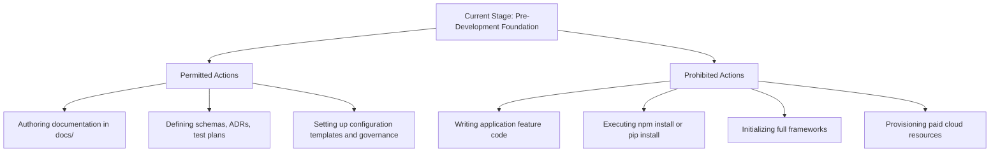

# System Boundaries & Permissions: DeltaCare

**Document Version**: 1.0.0  
**Authority**: Senior Software Architect  
**Status**: Active  

---

## 1. Permitted vs. Prohibited Actions by Stage

---

## 2. Explicit Permission Rules

| Action | Allowed in Stage 03? | Requires Explicit Approval? |
| :--- | :--- | :--- |
| Create documentation files in `docs/` | **Yes** | Yes (approved via Stage plan) |
| Create directory hierarchy | **Yes** | Yes (approved via Stage plan) |
| Create configuration templates (`.env.example`, `.gitignore`) | **Yes** | Yes |
| Run `npm install` or `pip install` | **No** | Yes |
| Write production route handlers in `apps/api/src/` | **No** | Yes (Stage 05+) |
| Write production UI components in `apps/web/src/` | **No** | Yes (Stage 05+) |
| Execute git commit or push to GitHub | **No** | **Yes — User explicitly requested to be asked before any git push** |

