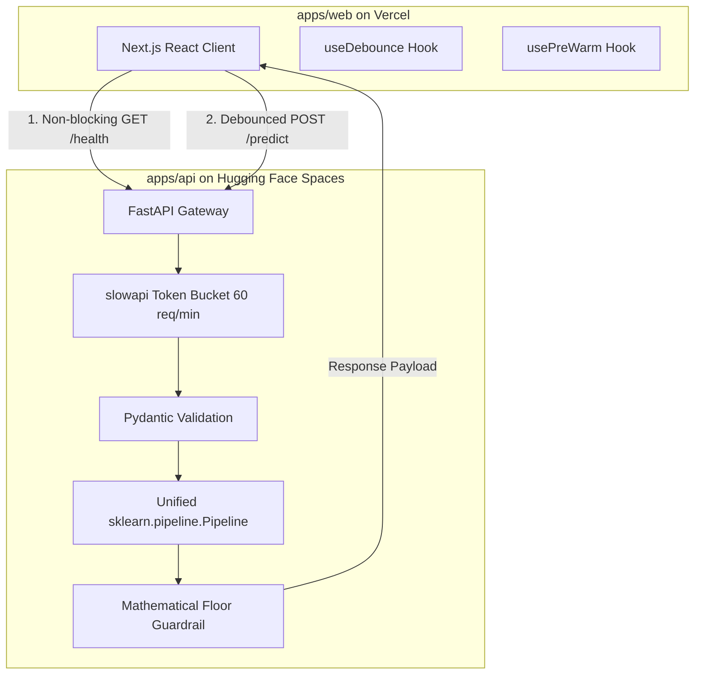

# Architecture Rules: DeltaCare

**Document Version**: 1.0.0  
**Authority**: Senior Software Architect  
**Status**: Authoritative Invariant Set  

---

## 1. System Topology & Decoupled Boundaries

DeltaCare follows a strict **Decoupled Architecture** with distinct runtime boundaries.

---

## 2. Inviolable Architectural Invariants

### 2.1 The Single Pipeline Artifact Pattern
- The API runtime must not duplicate or re-implement any feature scaling, one-hot encoding, or imputation logic.
- All transformations must be bundled inside `model.joblib`.
- Loading the model must be a single atomic operation: `pipeline = joblib.load(MODEL_PATH)`.
- Inference must accept a raw Pandas DataFrame: `predictions = pipeline.predict(df)`.

### 2.2 Client-Agnostic REST API
- The FastAPI service must remain purely client-agnostic.
- The API returns raw numbers and statistical error margins (`predicted_annual`, `confidence_margin_annual`).
- The frontend client is responsible for UX presentation, including currency formatting, dividing by 12 for the monthly hero view, and computing What-If savings deltas.

### 2.3 Port Configuration Standards
- **Hugging Face Spaces**: The Docker container **must** bind to `0.0.0.0` on port `7860`.
- **Local Development**: The API runs on `127.0.0.1:8000`, and the frontend runs on `localhost:3000`.

### 2.4 Cold-Start UX Hierarchy
- The frontend must orchestrate a 3-tier state progression during server spin-up:
  1. **$0 \le t < 2\text{s}$**: Inline button spinner with "Calculating...".
  2. **$2\text{s} \le t \le 10\text{s}$**: Pulsating skeleton loader with "Waking up the pricing engine... (this takes a few seconds)".
  3. **$t > 20\text{s}$**: Abort controller timeout prompting user to click "Retry".

