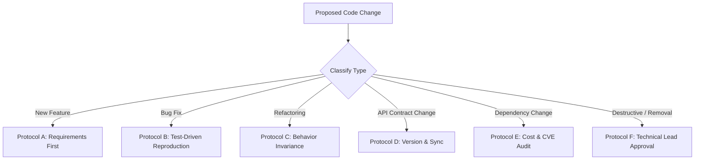

# Change Management Protocol: DeltaCare

**Document Version**: 1.0.0  
**Authority**: Senior Software Engineering Lead & DevOps Engineer  
**Status**: Authoritative Invariant Set  

---

## 1. Change Classification & Protocols

Every proposed change to DeltaCare falls into one of six categories, each governed by a specific protocol:

---

## 2. Protocol Details

### Protocol A: New Features
1. Verify feature is approved in `docs/SCOPE.md`.
2. Define requirement specification in `docs/FUNCTIONAL_REQUIREMENTS.md`.
3. Add Gherkin scenario to `docs/ACCEPTANCE_CRITERIA.md`.
4. Implement tests $\rightarrow$ Implement code $\rightarrow$ Pass CI.

### Protocol B: Bug Fixes
1. Author an automated test reproducing the reported defect (test must fail initially).
2. Implement the minimal fix to make the test pass.
3. Verify zero regressions across existing test suites.

### Protocol C: Refactoring
1. Run existing test suite to establish a green baseline.
2. Refactor code for performance or readability without modifying external signatures.
3. Re-run test suite. If any test fails, the refactor has broken an invariant and must be reverted.

### Protocol D: API Contract Changes (Restricted)
1. **Requires Technical Lead Approval**.
2. Update Pydantic schemas in `apps/api/src/schemas/`.
3. Synchronize TypeScript interfaces in `apps/web/src/types/`.
4. Update `docs/architecture/API_CONTRACT.md`.

### Protocol E: Dependency Changes (Restricted)
1. **Audit Budget Impact**: Must verify that the library does not require paid licenses or external paid APIs.
2. **Audit Memory Footprint**: Verify package does not inflate Docker image beyond Hugging Face RAM safety bounds.
3. Add package to `requirements.txt` or `package.json` with pinned version.

### Protocol F: Destructive Operations & Code Removal (Protected)
- **Strictly Prohibited** without explicit, written Technical Lead authorization.
- Deleting endpoints, dropping features, or removing test gates must be approved in `docs/OPEN_QUESTIONS.md`.

