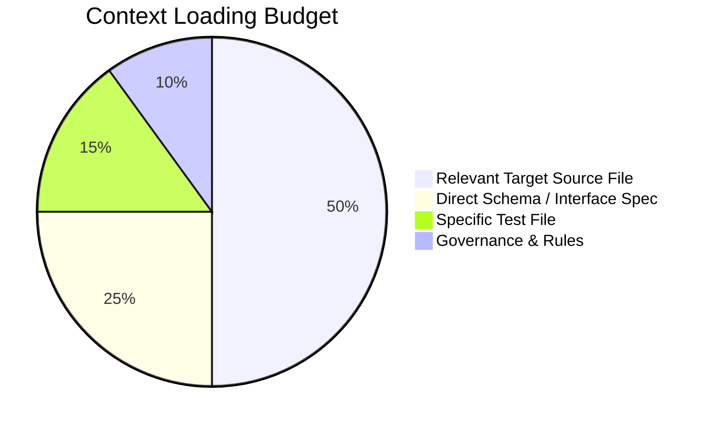

# Context Loading & Token Efficiency: DeltaCare

**Document Version**: 1.0.0  
**Authority**: Senior AI Architect  
**Status**: Authoritative Invariant Set  

---

## 1. Context Minimization Strategy

Large language models experience latency degradation and context window exhaustion when overloaded with unnecessary files. Agents must load context selectively and surgically.

---

## 2. Surgical Context Rules

1. **Do Not Slurp Whole Directories**:
   - Never run recursive reads on entire subtrees or read all files in `docs/` simultaneously.
   - Read `docs/INDEX.md` first to locate the single exact document needed for the task.
2. **Targeted Reading for Tasks**:
   - Working on an API endpoint? $\rightarrow$ Read `apps/api/src/schemas/quote.py` and `docs/FUNCTIONAL_REQUIREMENTS.md`.
   - Working on ML training? $\rightarrow$ Read `scripts/train_model.py` and `docs/NON_FUNCTIONAL_REQUIREMENTS.md`.
   - Working on frontend debounce? $\rightarrow$ Read `apps/web/src/hooks/useDebounce.ts` and `apps/web/src/components/BmiSlider.tsx`.
3. **Use Line-Range Reads for Large Files**:
   - If a file exceeds 200 lines, read only the target function or interface block using start/end line offsets.
4. **Leverage Pydantic & TypeScript as Self-Documenting Contracts**:
   - Treat type definition files (`apps/api/src/schemas/` and `apps/web/src/types/`) as the fastest, highest-density context for understanding system behavior.

