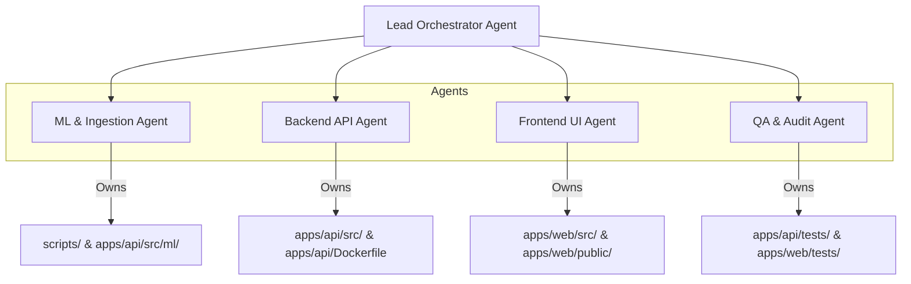

# Multi-Agent Coordination Protocol: DeltaCare

**Document Version**: 1.0.0  
**Authority**: Senior Software Architect & AI Governance Lead  
**Status**: Authoritative Invariant Set  

---

## 1. Domain Ownership Matrix

When multiple AI coding agents, subagents, or human developers collaborate on DeltaCare, conflicts are prevented by assigning explicit module ownership:

---

## 2. File Ownership Rules

| Domain / Subsystem | Primary Owner | Exclusive File Paths | Read-Only for Other Agents |
| :--- | :--- | :--- | :--- |
| **Machine Learning** | ML Specialist Agent | `scripts/ingest_data.py` `scripts/train_model.py` `apps/api/src/ml/` | `apps/api/models/model.joblib` |
| **Backend REST API** | Backend API Agent | `apps/api/src/main.py` `apps/api/src/core/` `apps/api/src/schemas/` `apps/api/Dockerfile` | `docs/architecture/API_CONTRACT.md` |
| **Frontend Client** | Frontend UI Agent | `apps/web/src/` `apps/web/package.json` `apps/web/tailwind.config.js` | `apps/web/src/types/` |
| **QA & Verification** | QA Specialist Agent | `apps/api/tests/` `apps/web/tests/` `scripts/audit_model.py` | Full codebase |
| **Core Governance** | Technical Lead / Orchestrator | `AGENTS.md` `.ai/` `docs/` | All agents must treat as read-only rules |

---

## 3. Conflict Resolution & Contract Handshakes

1. **API Contracts are Shared Locks**:
   - If the Frontend Agent requires a new property from the backend (e.g., `confidence_margin_monthly`), it **cannot** edit the backend code directly.
   - It must request the Backend Agent to update `apps/api/src/schemas/quote.py` and obtain Technical Lead approval (Restricted Tier).
2. **Sequential Integration Testing**:
   - Backend API changes must pass `pytest` before the Frontend Agent writes UI components that consume them.
   - The ML Pipeline must output a verified `model.joblib` passing `scripts/audit_model.py` before the Backend Agent integrates it into `predictor.py`.

