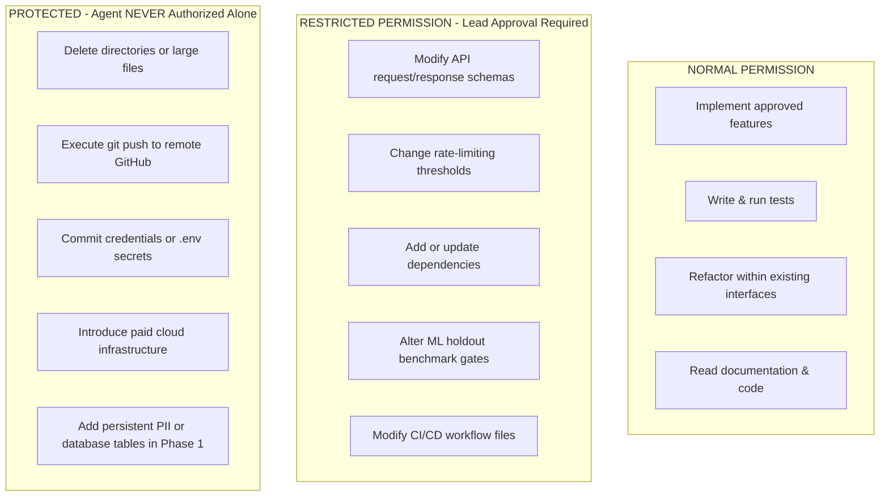

# Permission Model: DeltaCare

**Document Version**: 1.0.0  
**Authority**: Senior Security Architect & AI Governance Lead  
**Status**: Authoritative Invariant Set  

---

## 1. The Three Permission Tiers

To safeguard repository integrity, operational budgets, and security, actions by AI agents are divided into three distinct permission categories:

---

## 2. Granular Tier Specifications

### 2.1 NORMAL (Autonomous Execution Within Bounds)
*Agents may proceed autonomously without pausing for permission.*
- Inspecting, reading, and analyzing repository files.
- Implementing approved functional requirements inside `apps/api/src/` or `apps/web/src/`.
- Writing new unit and integration tests.
- Fixing localized bugs that do not change external API contracts.
- Updating documentation in `docs/` to keep it synchronized with approved code changes.

### 2.2 RESTRICTED (Explicit User Approval Required)
*Agents must explain the proposed change, outline consequences, and obtain explicit Technical Lead approval before proceeding.*
- Modifying Pydantic schemas in `apps/api/src/schemas/` or TypeScript types in `apps/web/src/types/`.
- Changing `slowapi` rate limits or CORS allowed origins.
- Adding new libraries to `requirements.txt` or `package.json`.
- Modifying GitHub Actions workflows in `.github/workflows/`.
- Relaxing machine learning benchmark thresholds ($R^2$, MAE).

### 2.3 PROTECTED (Strictly Prohibited for Autonomous Execution)
*Agents are technically and procedurally forbidden from executing these actions independently. Must be performed or explicitly commanded by the Technical Lead.*
- **Executing `git push` to GitHub** (Per user mandate: agent must ask first).
- Deleting root directories, documents in `docs/`, or git anchors.
- Creating persistent databases, user authentication systems, or PII storage in Phase 1.
- Removing or altering the legal underwriting disclaimer copy.
- Adding dependencies or services that require a credit card or incur cloud billing.

