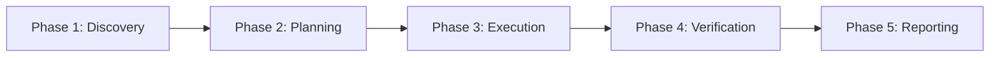

# Task Execution Protocol: DeltaCare

**Document Version**: 1.0.0  
**Authority**: Senior Software Engineering Lead & AI Governance Specialist  
**Status**: Authoritative Invariant Set  

---

## 1. The Standard AI Turn Execution Loop

Whenever an AI coding agent receives a task or user request, it must execute within this standard 4-step loop:

---

## 2. Step-by-Step Procedure

### Phase 1: Discovery & Context Gathering
1. Read the user prompt carefully.
2. Inspect relevant repository documentation in `docs/` and existing files in `apps/`.
3. Check `.ai/PERMISSION_MODEL.md` to classify whether the request is **NORMAL**, **RESTRICTED**, or **PROTECTED**.
4. If restricted or protected, **STOP** and ask for user approval before making changes.

### Phase 2: Planning & Validation
1. Formulate a minimal, targeted implementation plan.
2. Identify which files need to be edited or created.
3. Verify that the proposed changes strictly adhere to all invariants in `.ai/AGENT_RULES.md` and `.ai/ARCHITECTURE_RULES.md`.

### Phase 3: Execution
1. Edit or create files using precise, non-destructive tool calls.
2. Maintain all existing docstrings, comments, and types.
3. Update corresponding documentation in `docs/` if functional or architectural contracts change.

### Phase 4: Verification & Automated Testing
1. Execute tests relevant to the changed modules (`pytest`, component tests, or audit scripts).
2. Verify all tests pass with an exit code of `0`.
3. Inspect git status to ensure no unintended files were modified.

### Phase 5: Structured Reporting
End the response with a standardized report containing:
- **Files Modified / Created** (with markdown links).
- **Requirements Traced** (e.g., `FR-005`, `NFR-004`).
- **Verification Evidence** (test execution commands and outputs).
- **Open Questions or Next Steps**.

