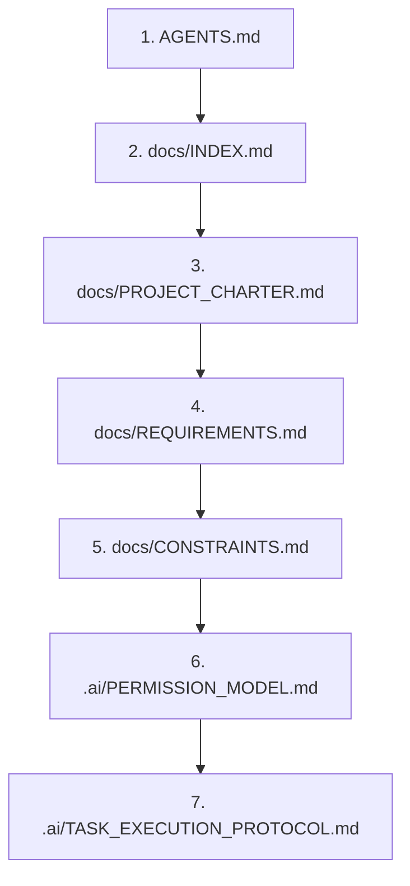

# AGENTS.md — Canonical AI Agent Instructions: DeltaCare

**Project**: DeltaCare  
**Repository**: `E:\DeltaCare`  
**Document Version**: 1.0.0  
**Phase**: Pre-Development Foundation Phase  
**Authority**: Senior Software Engineering Lead & AI Governance Specialist  
**Target Audience**: Any AI Coding Agent, Autonomous Programmer, or LLM-Powered IDE  

---

## 1. Project Identity & Purpose

**DeltaCare** is a transparent, data-driven health insurance premium prediction SaaS micro-product. It provides instant, anonymous, and statistically backed health insurance cost estimates using standard actuarial factors (Age, Gender, BMI, Dependents, Smoker Status, US Region).

- **Phase 1 Target**: 100% Stateless B2C Public Consumer Tool (no user accounts, no database, no PII harvesting).
- **Core Value Proposition**: Instant dual-metric pricing (monthly priority), statistical confidence intervals ($\pm \text{MAE}$), interactive What-If smoking savings badge, and debounced BMI exploration.
- **Strict Budget Constraint**: **$0.00 perpetual hosting spend**. Runs permanently on Vercel (Frontend) and Hugging Face Spaces (Backend: 16GB RAM / 2 vCPUs free CPU tier).

---

## 2. Mandatory Reading Order

Before proposing changes, executing commands, or generating code, every AI agent **MUST** read these files in the exact sequence listed:



1. [AGENTS.md](file:///e:/DeltaCare/AGENTS.md) *(This file — Primary agent entrypoint)*
2. [docs/INDEX.md](file:///e:/DeltaCare/docs/INDEX.md) *(Master documentation catalog)*
3. [docs/PROJECT_CHARTER.md](file:///e:/DeltaCare/docs/PROJECT_CHARTER.md) *(Scope and executive mandate)*
4. [docs/REQUIREMENTS.md](file:///e:/DeltaCare/docs/REQUIREMENTS.md) *(FR-001–FR-013 & NFR-001–NFR-011 traceability)*
5. [docs/CONSTRAINTS.md](file:///e:/DeltaCare/docs/CONSTRAINTS.md) *(Strict budget, compute, and architectural limits)*
6. [.ai/PERMISSION_MODEL.md](file:///e:/DeltaCare/.ai/PERMISSION_MODEL.md) *(Normal, Restricted, and Protected boundaries)*
7. [.ai/TASK_EXECUTION_PROTOCOL.md](file:///e:/DeltaCare/.ai/TASK_EXECUTION_PROTOCOL.md) *(Step-by-step turn execution rules)*

---

## 3. Repository Structure & Service Boundaries

```text
E:\DeltaCare/
├── AGENTS.md                  # Primary AI agent instructions (This document)
├── CONTRIBUTING.md            # Human & agent contribution guidelines
├── CODE_OF_CONDUCT.md         # Professional community standards
├── README.md                  # Human-facing project portal & quickstart
├── .ai/                       # Canonical AI Governance Framework
│   ├── AGENT_RULES.md         # Operational behavior, invariants, and boundaries
│   ├── CODING_STANDARDS.md    # Python/FastAPI & TypeScript/Next.js standards
│   ├── ARCHITECTURE_RULES.md  # Monorepo separation and zero-skew pipeline rules
│   ├── SECURITY_RULES.md      # Rate-limiting, CORS, and sanitization rules
│   ├── DATABASE_RULES.md      # Phase 1 statelessness & Phase 2 schema rules
│   ├── TESTING_RULES.md       # Pytest, holdout audits, and component tests
│   ├── DOCUMENTATION_RULES.md # Source-of-truth preservation rules
│   ├── CHANGE_MANAGEMENT.md   # Procedures for refactors, bugs, and API changes
│   ├── TASK_EXECUTION_PROTOCOL.md # Execution loop: Discover -> Plan -> Verify
│   ├── CONTEXT_LOADING.md     # Context efficiency guidelines for LLM turns
│   ├── DEFINITION_OF_DONE.md  # Completion checklists for all tasks
│   ├── PERMISSION_MODEL.md    # Normal vs. Restricted vs. Protected actions
│   ├── MULTI_AGENT_COORDINATION.md # Cross-agent file locking and handover
│   └── adapters/              # Thin shims for specific tools (Cursor, Copilot, etc.)
├── docs/                      # Authoritative single source of truth
├── apps/
│   ├── api/                   # Backend FastAPI service (Hugging Face Spaces)
│   └── web/                   # Frontend Next.js client (Vercel)
├── scripts/                   # Automated data ingestion, training, and audits
└── .github/workflows/         # CI/CD automated validation pipelines
```

---

## 4. Fundamental Source-of-Truth Rules

1. **The Repository is the Single Source of Truth**:
   - Model memory, transient session transcripts, and conversational assumptions are **never authoritative**.
   - If a conflict arises between user prompt phrasing and repository documentation, flag the conflict immediately and request clarification.
2. **No Unapproved Inventions**:
   - Do not invent requirements, change dataset features, introduce external paid APIs, or alter benchmark gates without explicit Technical Lead approval.
3. **Documentation Precedes Implementation**:
   - If a requirement or architecture changes, update the corresponding document in `docs/` first before touching application files.

---

## 5. Architectural & Coding Restrictions

1. **Zero Train-Serve Skew**:
   - Preprocessing (`StandardScaler`, `OneHotEncoder`) must **never** be manually re-implemented inside API routes or frontend code.
   - All transformations and the regressor must be encapsulated in a single `sklearn.pipeline.Pipeline` object serialized into `apps/api/models/model.joblib`.
2. **Stateless Backend Execution (Phase 1)**:
   - Zero databases, ORMs, session disks, or persistent user storage are permitted in Phase 1.
   - Do not introduce SQLite, PostgreSQL, MongoDB, Prisma, or SQLAlchemy during Phase 1.
3. **Strict Type Safety**:
   - **Backend**: 100% Pydantic request and response models. No untyped dictionaries or arbitrary JSON payloads.
   - **Frontend**: 100% strict TypeScript. Zero `any` types. Synchronize TypeScript interfaces with Pydantic schemas.
4. **Mathematical Guardrails**:
   - Backend predictions must be clamped to a business minimum floor ($\ge \$1,000/\text{year}$).

---

## 6. Security & Privacy Requirements

1. **Zero PII Retention**:
   - Never collect, store, or log names, email addresses, phone numbers, or IP addresses.
   - Server logs must output structured operational metrics and omit input feature payloads.
2. **Abuse Prevention**:
   - In-memory rate limiting via `slowapi` must be enforced on all prediction routes (max 60 requests/minute per client IP).
3. **CORS Isolation**:
   - CORS middleware must strictly whitelist only the Vercel production frontend origin and `localhost:3000` (development).

---

## 7. Testing & Quality Expectations

Every code change must pass automated verification before being considered done:
- **Model Benchmark Gate**: Holdout evaluation must pass $R^2 \ge 0.85$ and $\text{MAE} \le \$2,000$.
- **Backend Tests**: `pytest` verifying health check, prediction math, 422 input validation, and 429 rate limiting.
- **Frontend Tests**: Component and unit tests verifying form validation, debounced BMI slider behavior, and cold-start UX transitions.

---

## 8. Permission & Approval Workflow

Actions are strictly categorized into three permission tiers (see [.ai/PERMISSION_MODEL.md](file:///e:/DeltaCare/.ai/PERMISSION_MODEL.md)):
- **NORMAL**: Reading files, running non-destructive tests, editing designated feature files within existing architecture.
- **RESTRICTED**: Modifying API contracts, changing rate limits, altering pipeline architecture, modifying CI/CD workflows. **Requires explicit Technical Lead approval.**
- **PROTECTED**: Deleting directories, pushing to GitHub, modifying `.gitignore` to un-ignore secrets, introducing paid cloud dependencies. **Agents must NEVER execute these independently.**

---

## 9. Final Turn Reporting Standard

At the conclusion of any interaction turn, the agent must output a structured status summary:
1. **Actions Completed**: Clear list of files created, edited, or inspected.
2. **Traceability**: Requirements satisfied (e.g., `FR-005`, `NFR-001`).
3. **Verification**: Commands executed and their exit codes/results.
4. **Open Items / Approvals Needed**: Any decisions or restricted actions requiring Technical Lead authorization.

