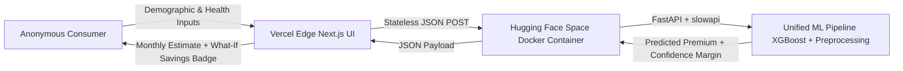

# DeltaCare

**A transparent, data-driven health insurance premium prediction SaaS micro-product.**

[](LICENSE)
[](docs/architecture/SYSTEM_TOPOLOGY.md)
[](docs/CONSTRAINTS.md)

---

## 1. Executive Overview

**DeltaCare** provides instantaneous, anonymous, and statistically reliable health insurance premium estimates. It eliminates the aggressive sales funnels, invasive personal data harvesting (no email, phone, or name required), and opaque underwriting that characterize legacy quoting portals.

Unlike traditional black-box calculators, DeltaCare provides **actionable transparency**:
- **Dual Metric Presentation**: Monthly pricing prioritized for consumer budgeting, backed by annualized totals.
- **Dynamic "What-If" Engine**: Real-time quantification of lifestyle choices (e.g., *"Quitting smoking could save you ~$3,200/year"*).
- **Statistical Confidence Ranges**: Honest representation of prediction margins based on model validation errors ($\pm \text{MAE}$) rather than misleading point estimates.
- **Strict $0 Perpetual Hosting Spend**: Architected to operate perpetually on free-tier infrastructure without out-of-memory crashes.



---

## 2. Repository Structure

```text
E:\DeltaCare/
├── .agent/              # Permanent operating instructions for AI coding assistants
├── .github/             # GitHub Actions CI/CD workflows and automated test gates
├── docs/                # Single source of truth (Charters, Requirements, Architecture, Security)
├── apps/
│   ├── api/             # Backend REST API (FastAPI + ML Pipeline + Dockerfile)
│   └── web/             # Frontend Client (Next.js / React + Tailwind CSS)
├── scripts/             # Headless automation (data ingestion, model training, benchmark audit)
├── .gitignore           # Root ignore rules (no raw data, no secrets, no large binaries)
├── .gitattributes       # Git LFS tracking for *.joblib model artifacts
└── README.md            # This document
```

---

## 3. Technology Stack & Infrastructure ($0 Perpetual Budget)

| Tier | Component | Technology | Hosting / Environment | Free-Tier Guarantee |
| :--- | :--- | :--- | :--- | :--- |
| **Brain** | ML Pipeline | Python, Scikit-learn, XGBoost, SHAP | Local / CI Automation | Fully scripted; zero external API costs |
| **Engine** | REST API | FastAPI, Pydantic, slowapi, Docker | **Hugging Face Spaces** | 16GB RAM / 2 vCPUs free CPU tier (prevents 512MB OOM crashes) |
| **Face** | Web Client | Next.js / React, Tailwind CSS, TypeScript | **Vercel** | Perpetual free tier, global edge CDN, automatic SSL, zero sleep |
| **State** | Persistence | Stateless (Phase 1) | In-Memory Token Bucket | No database hosting fees or PII storage risk |

---

## 4. Documentation Index

The repository serves as the definitive single source of truth. All design decisions and specifications are documented under `docs/`:

- **Master Index**: [`docs/INDEX.md`](docs/INDEX.md)
- **Project Charter**: [`docs/PROJECT_CHARTER.md`](docs/PROJECT_CHARTER.md)
- **Requirements Index**: [`docs/REQUIREMENTS.md`](docs/REQUIREMENTS.md)
- **Functional Requirements**: [`docs/FUNCTIONAL_REQUIREMENTS.md`](docs/FUNCTIONAL_REQUIREMENTS.md)
- **Non-Functional Requirements**: [`docs/NON_FUNCTIONAL_REQUIREMENTS.md`](docs/NON_FUNCTIONAL_REQUIREMENTS.md)
- **Acceptance Criteria**: [`docs/ACCEPTANCE_CRITERIA.md`](docs/ACCEPTANCE_CRITERIA.md)
- **Architecture & System Design**: [`docs/architecture/`](docs/architecture/)
- **Security & Privacy Policies**: [`docs/security/`](docs/security/)

---

## 5. Development Principles & AI Governance

Any developer or AI coding agent interacting with this repository must adhere to the rules in [`.agent/RULES.md`](.agent/RULES.md):
1. **Repository as Source of Truth**: Never invent requirements; trace all features to `docs/REQUIREMENTS.md`.
2. **Zero Train-Serve Skew**: All preprocessing and regression inference must reside in a single serialized `sklearn.pipeline.Pipeline` artifact (`model.joblib`).
3. **Stateless Privacy**: Zero persistent collection of PII.
4. **Predictive Benchmark Gates**: Automated test gates enforce $R^2 \ge 0.85$ and $\text{MAE} \le \$2,000$.

---

## 6. License

This project is licensed under the terms of the [MIT License](LICENSE).

