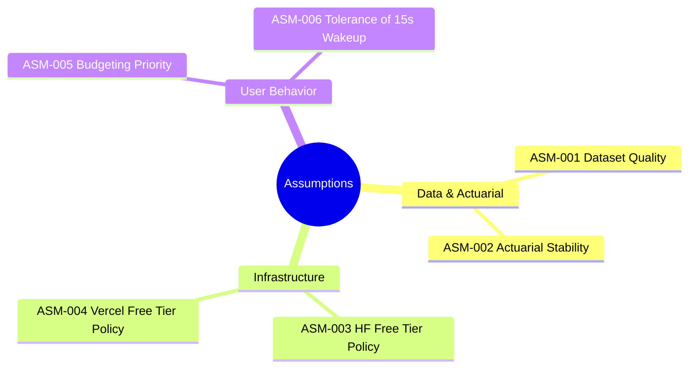

# Project Assumptions: DeltaCare

**Document Version**: 1.0.0  
**Phase**: Pre-Development Foundation Phase  
**Author**: Senior Requirements Engineer & Systems Analyst  
**Status**: Baseline Reference  

---

## 1. Assumptions Register

This document records the foundational assumptions under which the DeltaCare system is designed, architected, and prioritized. Should any of these assumptions prove invalid, the corresponding architectural decisions must be re-evaluated.

---

## 2. Detailed Assumptions Matrix

| Assumption ID | Category | Description | Impact if Invalid | Validation Strategy |
| :--- | :--- | :--- | :--- | :--- |
| **ASM-001** | Data & ML | The public US `insurance.csv` dataset (1,338 records) is sufficiently representative to train a robust baseline regression model for general US premium ballparking. | If biased or unrepresentative, predictions will have skewed geographical accuracy. | Use SHAP to identify feature sensitivity; clearly communicate non-binder status to consumers. |
| **ASM-002** | Actuarial | The non-linear interaction between smoking status and high BMI represents the dominant variance driver in individual health insurance charges. | If other factors dominate, model performance might underperform the $R^2 \ge 0.85$ target. | Validate feature importances via tree split metrics and SHAP summary plots during model development. |
| **ASM-003** | Platform | Hugging Face Spaces will maintain its perpetual free CPU tier (2 vCPUs, 16GB RAM, Docker SDK, no credit card required) for public spaces. | If discontinued, backend hosting must migrate to an alternative free container tier (e.g., Koyeb, Render, or Railway credits). | Monitor Hugging Face terms of service; ensure standard Docker packaging for instant portability. |
| **ASM-004** | Platform | Vercel will continue to offer its zero-cost Hobby tier with edge CDN, free SSL, and zero container sleep for static/React frontends. | If discontinued, frontend can seamlessly migrate to Cloudflare Pages or Netlify with zero code changes. | Next.js build output remains standard static/edge export compatible. |
| **ASM-005** | User Behavior | Prospective health insurance shoppers evaluate and budget plan costs primarily on a **monthly basis** rather than a lump-sum annual basis. | If consumers prefer annual figures, the visual hierarchy would confuse shoppers. | Dual metric display ensures both monthly and annual figures are visible simultaneously. |
| **ASM-006** | User Experience | Users are willing to wait 12–15 seconds during occasional cold starts if transparent, staged visual feedback ("Waking up the pricing engine...") is provided. | If users bounce within 5 seconds regardless of feedback, cold-start masking is insufficient. | Mitigated by optimistic background `GET /health` pre-warming dispatched on page mount. |
| **ASM-007** | Regulatory | Providing statistical health insurance estimates anonymously without collecting PII does not subject the platform to HIPAA compliance or licensed broker filing requirements. | If classified as licensed insurance solicitation, legal operations would be restricted. | Maintain strict non-binder disclaimer; avoid recommending specific carrier contracts in Phase 1. |

