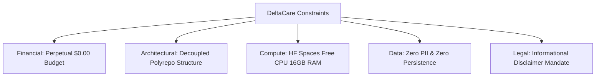

# Project Constraints: DeltaCare

**Document Version**: 1.0.0  
**Phase**: Pre-Development Foundation Phase  
**Author**: Senior Software Architect & DevOps Engineer  
**Status**: Baseline Reference  

---

## 1. Constraint Categories Overview

Engineering decisions in DeltaCare are bound by strict operational, economic, architectural, and regulatory constraints. These boundaries are non-negotiable for Phase 1.

---

## 2. Detailed Constraints Matrix

### 2.1 Economic & Financial Constraints
- **Strict Perpetual $0 Spend**: The project has zero budget allocation ($0.00).
- **Prohibited Cloud Services**: Services requiring active credit cards or offering only temporary 12-month free tiers (e.g., standard AWS EC2, AWS Elastic Beanstalk, Google Cloud Compute Engine, paid Fly.io instances) are strictly prohibited.
- **Allowed Infrastructure**:
  - **Frontend**: Vercel Hobby Free Tier (perpetual free edge CDN, automatic SSL, no sleep).
  - **Backend**: Hugging Face Spaces Free CPU Tier (perpetual free Docker container, 2 vCPUs, 16GB RAM, no credit card required).

### 2.2 Architectural & Technical Constraints
- **Stateless Execution**: The backend must remain purely transactional in Phase 1. No databases (PostgreSQL, MongoDB, SQLite), file uploads, or persistent session disks may be introduced.
- **Decoupled Polyrepo Mandate**: The API (`deltacare-api`) and Web UI (`deltacare-frontend`) must reside in clean, decoupled repository structures (or isolated directories within the DeltaCare umbrella) to prevent cross-service rebuilds and enable platform-specific CI/CD webhooks.
- **Single Pipeline Artifact**: Model preprocessing (scaling, one-hot encoding) and regression prediction must be packaged together in a single `model.joblib` artifact. Splitting transformers from regressors across different files is prohibited to avoid train-serve skew.

### 2.3 Compute & Resource Constraints
- **Container Memory Ceiling**: Total RAM usage must not exceed 2.0GB, operating well within Hugging Face Spaces' 16GB ceiling while avoiding 512MB OOM crash vulnerabilities.
- **Cold-Start Latency**: The application must tolerate container idling after ~48 hours of inactivity and handle 15–20s initial spin-up times purely through client-side UX design.

### 2.4 Security & Regulatory Constraints
- **Zero PII Collection**: The system must never request, ingest, or log names, email addresses, phone numbers, or social security numbers.
- **Rate-Limiting Ceiling**: API endpoints must restrict client traffic to 60 requests/minute per IP using in-memory token buckets (`slowapi`).
- **CORS Whitelisting**: The API must refuse requests from unauthorized browser origins, permitting only the verified Vercel production domain and local development host.
- **Mandatory Legal Disclaimer**: Every calculated quote must display the approved non-binder underwriting disclaimer to prevent consumer misrepresentation or regulatory non-compliance.

