# DeltaCare Documentation Index

**Phase**: Pre-Development Foundation Phase  
**Current Stage**: Stage 14 — Final Foundation Verification & AI Readiness  
**Repository Location**: `E:\DeltaCare`  
**Status**: Authoritative Single Source of Truth  

---

## 1. Documentation Structure & Map

This index organizes all foundational requirements, system definitions, user models, operational constraints, architectural designs, Architecture Decision Records (ADRs), database governance, security policies, quality assurance testing plans, DevOps infrastructure specifications, development workflows, production operations, and final verification audits for the **DeltaCare** project.

```mermaid
graph TD
    INDEX[INDEX.md] --> CHARTER[PROJECT_CHARTER.md]
    INDEX --> REQUIREMENTS[REQUIREMENTS.md]
    INDEX --> DEC_REG[docs/PROJECT_DECISION_REGISTER.md]
    INDEX --> ARCH_INDEX[System Architecture]
    INDEX --> DECISIONS[docs/decisions/ ADR System]
    INDEX --> DB_INDEX[docs/database/ Data Architecture]
    INDEX --> SEC_INDEX[docs/security/ Security Framework]
    INDEX --> QA_INDEX[docs/testing/ QA & Testing System]
    INDEX --> DEVOPS_INDEX[docs/devops/ DevOps & CI/CD]
    INDEX --> OPS_INDEX[docs/operations/ SRE Operations]
    INDEX --> AUDITS_INDEX[docs/audits/ Final Verification Audits]
    INDEX --> WORKFLOWS_INDEX[.ai/workflows/ Development Workflows]
    INDEX --> TEMPLATES_INDEX[.ai/templates/ Engineering Templates]
    INDEX --> GOVERNANCE[AI Agent Governance]
```

---

## 2. Foundation Audits & Verification Reports ([`docs/audits/`](audits/))

| Document | File Link | Focus & Audit Scope |
| :--- | :--- | :--- |
| **Final Readiness Report** | [FINAL_FOUNDATION_READINESS.md](audits/FINAL_FOUNDATION_READINESS.md) | **FINAL VERDICT: READY**. Autonomous agent simulation across 7 engineering scenarios and repository integrity check. |
| **Foundation Audit** | [FOUNDATION_AUDIT.md](audits/FOUNDATION_AUDIT.md) | Comprehensive baseline audit across Stages 01–12; overall readiness verdict (**Grade A+ / 99.4%**). |
| **Documentation Coverage** | [DOCUMENTATION_COVERAGE.md](audits/DOCUMENTATION_COVERAGE.md)| 100% coverage inventory verifying 98 authoritative documentation files and link integrity. |
| **Consistency Report** | [CONSISTENCY_REPORT.md](audits/CONSISTENCY_REPORT.md) | Full cross-check across Charter, Requirements, Architecture, ADRs, Security, and Testing (0 contradictions). |
| **AI Readiness Report** | [AI_READINESS_REPORT.md](audits/AI_READINESS_REPORT.md)| Autonomous agent usability simulation: 12/12 competency checks passed; zero-prior-context readiness. |
| **Unresolved Decisions** | [UNRESOLVED_DECISIONS.md](audits/UNRESOLVED_DECISIONS.md)| Decision status log: 10/10 Phase 1 decisions Accepted; 0 blockers; Phase 2/3 roadmap documented. |
| **Risk Register** | [RISK_REGISTER.md](audits/RISK_REGISTER.md) | Comprehensive risk matrix (R-01 to R-06) covering cold starts, scraping, PII, and OOM with active controls. |

---

## 3. Production Operations & Site Reliability Engineering ([`docs/operations/`](operations/))

- [OPERATIONS_OVERVIEW.md](operations/OPERATIONS_OVERVIEW.md)
- [LOGGING_STRATEGY.md](operations/LOGGING_STRATEGY.md)
- [MONITORING_STRATEGY.md](operations/MONITORING_STRATEGY.md)
- [METRICS_AND_ALERTING.md](operations/METRICS_AND_ALERTING.md)
- [HEALTH_CHECKS.md](operations/HEALTH_CHECKS.md)
- [INCIDENT_MANAGEMENT.md](operations/INCIDENT_MANAGEMENT.md)
- [DISASTER_RECOVERY.md](operations/DISASTER_RECOVERY.md)
- [BACKUP_VERIFICATION.md](operations/BACKUP_VERIFICATION.md)
- [CAPACITY_PLANNING.md](operations/CAPACITY_PLANNING.md)
- [MAINTENANCE_PROCEDURES.md](operations/MAINTENANCE_PROCEDURES.md)
- [TROUBLESHOOTING_GUIDE.md](operations/TROUBLESHOOTING_GUIDE.md)
- [RELEASE_OPERATIONS.md](operations/RELEASE_OPERATIONS.md)

---

## 4. DevOps, CI/CD & Deployment Architecture ([`docs/devops/`](devops/))

- [GIT_GOVERNANCE.md](devops/GIT_GOVERNANCE.md)
- [CI_CD_STRATEGY.md](devops/CI_CD_STRATEGY.md)
- [BUILD_PROCESS.md](devops/BUILD_PROCESS.md)
- [DEPLOYMENT_STRATEGY.md](devops/DEPLOYMENT_STRATEGY.md)
- [RELEASE_MANAGEMENT.md](devops/RELEASE_MANAGEMENT.md)
- [ROLLBACK_STRATEGY.md](devops/ROLLBACK_STRATEGY.md)
- [ENVIRONMENT_MANAGEMENT.md](devops/ENVIRONMENT_MANAGEMENT.md)
- [CONFIGURATION_MANAGEMENT.md](devops/CONFIGURATION_MANAGEMENT.md)
- [INFRASTRUCTURE_MANAGEMENT.md](devops/INFRASTRUCTURE_MANAGEMENT.md)

---

## 5. Testing & Quality Assurance Architecture ([`docs/testing/`](testing/))

- [TEST_STRATEGY.md](testing/TEST_STRATEGY.md)
- [TEST_PLAN.md](testing/TEST_PLAN.md)
- [UNIT_TESTING.md](testing/UNIT_TESTING.md)
- [INTEGRATION_TESTING.md](testing/INTEGRATION_TESTING.md)
- [API_TESTING.md](testing/API_TESTING.md)
- [E2E_TESTING.md](testing/E2E_TESTING.md)
- [SECURITY_TESTING.md](testing/SECURITY_TESTING.md)
- [PERFORMANCE_TESTING.md](testing/PERFORMANCE_TESTING.md)
- [LOAD_TESTING.md](testing/LOAD_TESTING.md)
- [RECOVERY_TESTING.md](testing/RECOVERY_TESTING.md)
- [REGRESSION_TESTING.md](testing/REGRESSION_TESTING.md)
- [ACCEPTANCE_TESTING.md](testing/ACCEPTANCE_TESTING.md)
- [TEST_DATA_MANAGEMENT.md](testing/TEST_DATA_MANAGEMENT.md)
- [BUG_REPORTING.md](testing/BUG_REPORTING.md)

---

## 6. Application Security & Threat Modeling ([`docs/security/`](security/))

- [SECURITY.md](security/SECURITY.md)
- [SECURITY_ARCHITECTURE.md](security/SECURITY_ARCHITECTURE.md)
- [THREAT_MODEL.md](security/THREAT_MODEL.md)
- [ATTACK_SURFACE.md](security/ATTACK_SURFACE.md)
- [AUTHENTICATION_SECURITY.md](security/AUTHENTICATION_SECURITY.md)
- [AUTHORIZATION_POLICY.md](security/AUTHORIZATION_POLICY.md)
- [ACCESS_CONTROL.md](security/ACCESS_CONTROL.md)
- [ENCRYPTION_POLICY.md](security/ENCRYPTION_POLICY.md)
- [SECRET_MANAGEMENT.md](security/SECRET_MANAGEMENT.md)
- [INPUT_VALIDATION.md](security/INPUT_VALIDATION.md)
- [OUTPUT_ENCODING.md](security/OUTPUT_ENCODING.md)
- [SESSION_SECURITY.md](security/SESSION_SECURITY.md)
- [RATE_LIMITING.md](security/RATE_LIMITING.md)
- [AUDIT_LOGGING.md](security/AUDIT_LOGGING.md)
- [DATA_PRIVACY.md](security/DATA_PRIVACY.md)
- [INCIDENT_RESPONSE.md](security/INCIDENT_RESPONSE.md)
- [SECURITY_CHECKLIST.md](security/SECURITY_CHECKLIST.md)
- [VULNERABILITY_MANAGEMENT.md](security/VULNERABILITY_MANAGEMENT.md)

---

## 7. Database & Data Integrity Governance ([`docs/database/`](database/))

- [DATABASE_DESIGN.md](database/DATABASE_DESIGN.md)
- [ER_DIAGRAM.md](database/ER_DIAGRAM.md)
- [SCHEMA_REFERENCE.md](database/SCHEMA_REFERENCE.md)
- [DATA_DICTIONARY.md](database/DATA_DICTIONARY.md)
- [TABLE_RELATIONSHIPS.md](database/TABLE_RELATIONSHIPS.md)
- [CONSTRAINTS.md](database/CONSTRAINTS.md)
- [INDEXING_STRATEGY.md](database/INDEXING_STRATEGY.md)
- [TRANSACTION_RULES.md](database/TRANSACTION_RULES.md)
- [CONCURRENCY_CONTROL.md](database/CONCURRENCY_CONTROL.md)
- [MIGRATION_POLICY.md](database/MIGRATION_POLICY.md)
- [DATA_RETENTION_POLICY.md](database/DATA_RETENTION_POLICY.md)
- [BACKUP_AND_RECOVERY.md](database/BACKUP_AND_RECOVERY.md)
- [DATA_INTEGRITY_RULES.md](database/DATA_INTEGRITY_RULES.md)

---

## 8. Decisions & Architecture Decision Records (ADRs) ([`docs/decisions/`](decisions/))

- **Central Decision Register**: [PROJECT_DECISION_REGISTER.md](PROJECT_DECISION_REGISTER.md) (Master tracking DEC-001 through DEC-020)
- [ADR-001: Adoption of Decoupled Monorepo Structure](decisions/001-decoupled-monorepo.md)
- [ADR-002: Perpetual $0 Infrastructure & Hosting Strategy](decisions/002-zero-dollar-hosting-strategy.md)
- [ADR-003: Unified Scikit-Learn Pipeline Serialization](decisions/003-unified-sklearn-pipeline.md)
- [ADR-004: Stateless B2C Architecture for Phase 1 MVP](decisions/004-stateless-b2c-mvp.md)
- [ADR-005: In-Memory Token Bucket Abuse Prevention via slowapi](decisions/005-in-memory-token-bucket-rate-limiting.md)
- [ADR-006: Tree Ensemble Model Selection (XGBoost)](decisions/006-tree-ensemble-xgboost-regression.md)
- [ADR-007: 3-Stage Cold-Start Progress UX Hierarchy](decisions/007-three-stage-cold-start-ux.md)
- [ADR-008: Statistical Confidence Margins via Validation MAE](decisions/008-static-holdout-mae-confidence-bounds.md)
- [ADR-009: Client-Side 400ms Debounce Traffic Damping](decisions/009-client-side-debounce-damping.md)
- [ADR-010: Zero-PII Structured Logging to STDOUT](decisions/010-structured-stdout-log-sanitization.md)

---

## 9. System Architecture & Technical Design ([`docs/architecture/`](architecture/))

- [SYSTEM_ARCHITECTURE.md](architecture/SYSTEM_ARCHITECTURE.md)
- [HIGH_LEVEL_DESIGN.md](architecture/HIGH_LEVEL_DESIGN.md)
- [LOW_LEVEL_DESIGN.md](architecture/LOW_LEVEL_DESIGN.md)
- [COMPONENT_ARCHITECTURE.md](architecture/COMPONENT_ARCHITECTURE.md)
- [MODULE_BOUNDARIES.md](architecture/MODULE_BOUNDARIES.md)
- [DATA_FLOW.md](architecture/DATA_FLOW.md)
- [REQUEST_LIFECYCLE.md](architecture/REQUEST_LIFECYCLE.md)
- [AUTHENTICATION_FLOW.md](architecture/AUTHENTICATION_FLOW.md)
- [AUTHORIZATION_FLOW.md](architecture/AUTHORIZATION_FLOW.md)
- [ERROR_HANDLING.md](architecture/ERROR_HANDLING.md)
- [BACKGROUND_JOBS.md](architecture/BACKGROUND_JOBS.md)
- [INTEGRATION_ARCHITECTURE.md](architecture/INTEGRATION_ARCHITECTURE.md)
- [NETWORK_ARCHITECTURE.md](architecture/NETWORK_ARCHITECTURE.md)
- [SCALABILITY_STRATEGY.md](architecture/SCALABILITY_STRATEGY.md)
- [AVAILABILITY_STRATEGY.md](architecture/AVAILABILITY_STRATEGY.md)
- [FAILURE_RECOVERY.md](architecture/FAILURE_RECOVERY.md)

---

## 10. Requirements & Project Charter

- [PROJECT_CHARTER.md](PROJECT_CHARTER.md)
- [PROJECT_VISION.md](PROJECT_VISION.md)
- [PROBLEM_STATEMENT.md](PROBLEM_STATEMENT.md)
- [PROJECT_OBJECTIVES.md](PROJECT_OBJECTIVES.md)
- [SCOPE.md](SCOPE.md)
- [REQUIREMENTS.md](REQUIREMENTS.md)
- [FUNCTIONAL_REQUIREMENTS.md](FUNCTIONAL_REQUIREMENTS.md)
- [NON_FUNCTIONAL_REQUIREMENTS.md](NON_FUNCTIONAL_REQUIREMENTS.md)
- [USER_ROLES.md](USER_ROLES.md)
- [USER_JOURNEYS.md](USER_JOURNEYS.md)
- [USE_CASES.md](USE_CASES.md)
- [ACCEPTANCE_CRITERIA.md](ACCEPTANCE_CRITERIA.md)
- [CONSTRAINTS.md](CONSTRAINTS.md)
- [ASSUMPTIONS.md](ASSUMPTIONS.md)
- [OPEN_QUESTIONS.md](OPEN_QUESTIONS.md)
- [GLOSSARY.md](GLOSSARY.md)
