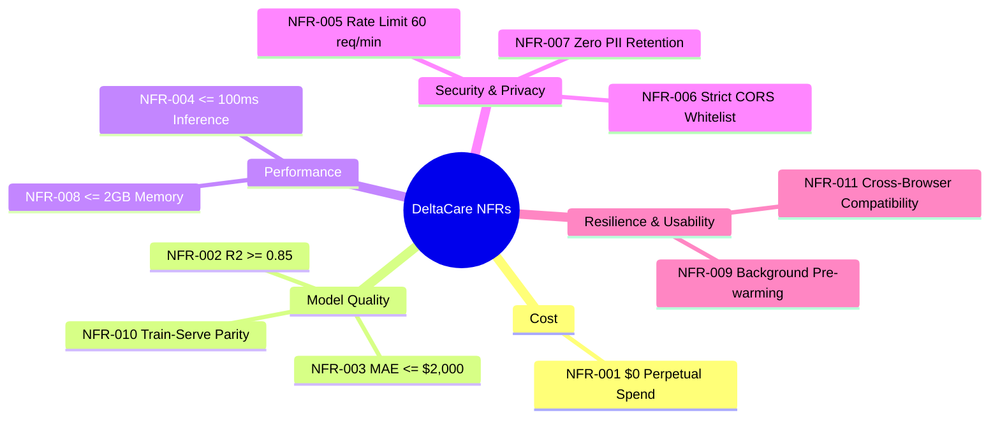

# Non-Functional Requirements: DeltaCare

**Document Version**: 1.0.0  
**Phase**: Pre-Development Foundation Phase  
**Author**: Senior Requirements Engineer & DevOps/Security Architect  
**Status**: Baseline Reference  

---

## 1. Quality Dimensions Overview

Non-functional requirements specify the operational bounds, performance thresholds, security constraints, and platform limits under which **DeltaCare** operates. Because the system runs under a strict **$0 perpetual hosting constraint**, non-functional parameters are heavily tuned to free-tier cloud realities.

---

## 2. Detailed NFR Specifications

### NFR-001: Perpetual $0 Cloud Hosting Spend
- **Category**: Cost & Sustainability | **Priority**: Critical | **Status**: Confirmed
- **Metric**: Total monthly infrastructure and platform expenditure must equal exactly **\$0.00**.
- **Boundaries**:
  - Frontend hosted on Vercel Hobby Free Tier.
  - Backend API hosted on Hugging Face Spaces (Free CPU Docker tier).
  - No credit card registration required; zero paid cloud dependencies.

### NFR-002: Model Goodness of Fit ($R^2$)
- **Category**: Machine Learning Performance | **Priority**: High | **Status**: Confirmed
- **Metric**: The coefficient of determination ($R^2$) evaluated on holdout test split must be $\ge 0.85$.
- **Rationale**: An $R^2 \ge 0.85$ demonstrates that the tree ensemble captures $> 85\%$ of the empirical variance in medical charges across demographic groups.

### NFR-003: Model Prediction Error ($\text{MAE}$)
- **Category**: Machine Learning Accuracy | **Priority**: High | **Status**: Confirmed
- **Metric**: Mean Absolute Error ($\text{MAE}$) on holdout test split must be $\le \$2,000$ (representing $\le \$166.67/\text{month}$).
- **Rationale**: Keeps the displayed confidence interval tight enough to provide meaningful budgeting utility to prospective policyholders.

### NFR-004: Active Inference Latency
- **Category**: Performance | **Priority**: High | **Status**: Confirmed
- **Metric**: Server processing time for a valid `POST /predict` request must be $\le 100\text{ms}$ (excluding network round-trip time) when the container is in an active state.
- **Verification**: Benchmarked using automated HTTP benchmarking scripts (e.g., `autocannon` or `locust`) at 10 concurrent requests.

### NFR-005: In-Memory Abuse Prevention & Rate Limiting
- **Category**: Security & Resilience | **Priority**: Critical | **Status**: Confirmed
- **Metric**: Enforce an in-memory token-bucket limit of **60 requests per minute per client IP** using `slowapi`.
- **Behavior**: Requests exceeding 60/min receive an immediate `HTTP 429 Too Many Requests` response with a `Retry-After` header. Frontend displays a non-destructive notice: *"Please wait a moment before recalculating."*

### NFR-006: Cross-Origin Resource Sharing (CORS) Isolation
- **Category**: Security | **Priority**: Critical | **Status**: Confirmed
- **Metric**: Backend `CORSMiddleware` must restrict accepted origins strictly to:
  1. The deployed Vercel production frontend domain (e.g., `https://deltacare.vercel.app`).
  2. `http://localhost:3000` (strictly during local development).
- **Behavior**: Direct cross-origin browser fetch attempts from arbitrary domains are blocked at the pre-flight `OPTIONS` handshake.

### NFR-007: Privacy & Zero PII Retention
- **Category**: Privacy & Regulatory | **Priority**: Critical | **Status**: Confirmed
- **Metric**: Zero storage of user-submitted health and demographic attributes.
- **Enforcement**:
  - Backend operates completely statelessly.
  - No database connections exist in Phase 1.
  - Server application logs must sanitize or omit input payloads to prevent indirect PII capture.

### NFR-008: Memory Footprint & OOM Immunity
- **Category**: Reliability | **Priority**: High | **Status**: Confirmed
- **Metric**: Total Docker container memory utilization must not exceed **2.0 GB** during startup, model deserialization, or peak concurrent inference.
- **Rationale**: Fits comfortably within the 16.0 GB RAM allocation of Hugging Face Spaces free CPU tier, providing an $8\times$ safety margin and preventing Out-Of-Memory (OOM) crashes common on 512MB platforms.

### NFR-009: Cold-Start Optimistic Pre-Warming
- **Category**: Availability & UX | **Priority**: Medium | **Status**: Confirmed
- **Metric**: Frontend web client must dispatch an asynchronous, non-blocking `GET /health` request upon DOM mounting.
- **Rationale**: Silently triggers Hugging Face container spin-up while the user is actively reading the form and entering their initial demographic data, masking cold-start delay before the first quote request is submitted.

### NFR-010: Train-Serve Preprocessing Parity
- **Category**: Maintainability & Integrity | **Priority**: Critical | **Status**: Confirmed
- **Metric**: Exactly 100% code parity between training data transformation and online inference transformation.
- **Enforcement**: Preprocessing logic must not be re-implemented in the API route. The API must invoke the serialized `Pipeline` object directly (`pipeline.predict(df)`).

### NFR-011: Cross-Browser & Device Compatibility
- **Category**: Usability & Accessibility | **Priority**: High | **Status**: Confirmed
- **Metric**: The web interface must render and function without layout breaks or script errors across:
  - Chromium-based browsers (Chrome, Edge, Brave) v100+.
  - Mozilla Firefox v100+.
  - Apple Safari (macOS & iOS) v15+.
  - Responsive screen viewports from 360px (mobile) to 2560px (ultra-wide desktop).

