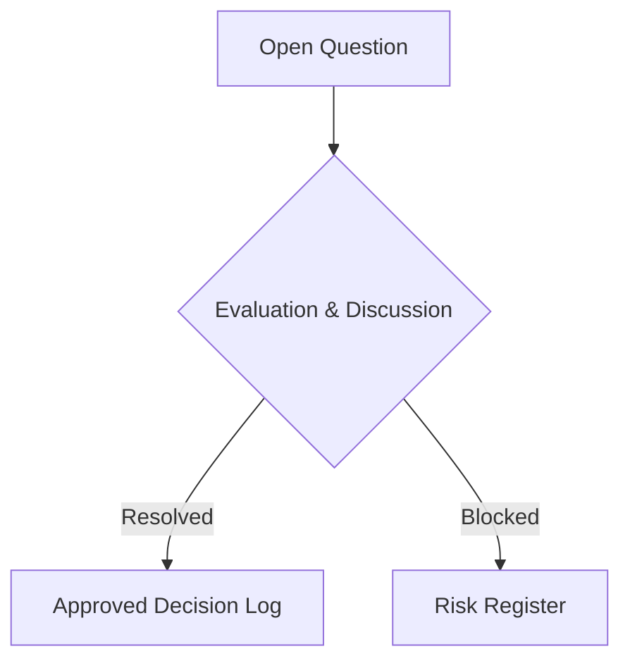

# Open Questions & Decision Log: DeltaCare

**Document Version**: 1.0.0  
**Phase**: Pre-Development Foundation Phase  
**Author**: Senior Requirements Engineer & Product Manager  
**Status**: Baseline Reference  

---

## 1. Open Questions Register

This document tracks unresolved engineering, design, and product questions. Items remain here until formally decided and moved to the Approved Decision Log.

---

## 2. Active Open Questions

| Question ID | Category | Question | Proposed Options | Current Recommendation | Status |
| :--- | :--- | :--- | :--- | :--- | :--- |
| **OQ-001** | Frontend Framework | Should the frontend be built using **Next.js (App Router)** or plain **Vite + React**? | A: Next.js (SSR/Static export, rich ecosystem, easy Vercel deploy). B: Vite + React (Ultra-lightweight SPA, zero server runtime, fastest build). | **Option B (Vite + React)** or **Next.js static export**. Since the frontend is purely a client-side calculator talking to an external API, a pure static SPA avoids all Node.js server overhead on Vercel. | Pending Technical Lead Review |
| **OQ-002** | ML Tree Library | Should the regression model standardize on **XGBoost** (`xgboost`) or **LightGBM** (`lightgbm`)? | A: XGBoost (Standard, robust, highly supported). B: LightGBM (Extremely small binary footprint, faster CPU training). | **Option A (XGBoost)**. Both easily hit $R^2 \ge 0.85$, but XGBoost has more consistent pre-built wheels across Python versions in Docker. | Proposed (XGBoost) |
| **OQ-003** | Local Dev Directory Strategy | Inside `E:\DeltaCare`, should we organize the codebase as a **Monorepo** (e.g., `apps/api` and `apps/web`) or **Two sub-repositories**? | A: Monorepo with top-level documentation and subfolders. B: Distinct git repositories pushed separately to GitHub. | **Option A (Monorepo with isolated subfolders)**. Enables single-source documentation in `E:\DeltaCare\docs`, while Vercel and Hugging Face can deploy directly from subdirectories (`apps/web` and `apps/api`). | Proposed (Monorepo Structure) |
| **OQ-004** | Error Margin Calculation | Should the prediction range bracket use a static validation **MAE** or a dynamic **quantile regression** (e.g., 10th and 90th percentiles)? | A: Static additive margin ($\text{predicted} \pm \text{MAE}$). B: Quantile regression tree predicting upper and lower bounds directly. | **Option A (Static MAE)** for Phase 1 to minimize model serialization complexity; consider Option B for Phase 2. | Proposed (Static MAE) |

---

## 3. Approved Decision Log (Historical Sign-Offs)

| Decision ID | Date | Approved Decision | Approver |
| :--- | :--- | :--- | :--- |
| **DEC-001** | 2026-11-08 | Official project name confirmed as **DeltaCare**. | Technical Lead |
| **DEC-002** | 2026-11-08 | Authoritative physical repository location locked at `E:\DeltaCare`. | Technical Lead |
| **DEC-003** | 2026-11-08 | Strict perpetual **$0.00 infrastructure budget** enforced (Vercel + Hugging Face Spaces Free CPU tier). | Technical Lead |
| **DEC-004** | 2026-11-08 | Phase 1 scope locked as a **100% Stateless B2C Public Consumer Tool**; no databases, no user accounts, no PII harvesting. | Technical Lead |
| **DEC-005** | 2026-11-08 | Baseline dataset confirmed as US `insurance.csv` (1,338 records). | Technical Lead |
| **DEC-006** | 2026-11-08 | Model architecture confirmed as Tree Ensemble with single serialized `Pipeline` artifact (`model.joblib`) to guarantee zero train-serve skew. | Technical Lead |
| **DEC-007** | 2026-11-08 | Minimum predictive quality benchmark locked: $R^2 \ge 0.85$ and $\text{MAE} \le \$2,000$. | Technical Lead |
| **DEC-008** | 2026-11-08 | Rate limiting enforced at 60 requests/min per IP via in-memory token buckets (`slowapi`). | Technical Lead |
| **DEC-009** | 2026-11-08 | Cold-start mitigation strategy approved: 3-stage visual progress states (0–2s, 3–10s, 20s timeout) + optimistic background `GET /health` pre-warming. | Technical Lead |

