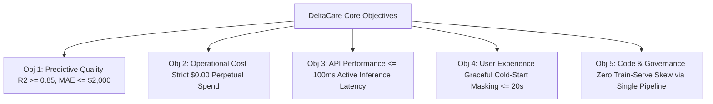

# Project Objectives: DeltaCare

**Document Version**: 1.0.0  
**Phase**: Pre-Development Foundation Phase  
**Author**: Senior Requirements Engineer & Product Manager  
**Status**: Baseline Reference  

---

## 1. High-Level Objectives

The strategic intent of **DeltaCare** is to build and deploy a production-ready, highly accurate, and completely free-to-operate micro-product that solves the consumer insurance estimation problem while setting the architectural foundation for a future B2B SaaS platform.

---

## 2. Specific, Measurable Objectives (SMART)

### Objective 1: Predictive Quality & Actuarial Soundness
- **Target**: Achieve an $R^2$ score $\ge 0.85$ and a Mean Absolute Error ($\text{MAE}$) $\le \$2,000$ on holdout test data using the standard US `insurance.csv` dataset.
- **Rationale**: An MAE of $\le \$2,000$ guarantees that the monthly estimate presented to consumers is within $\approx \$166/\text{month}$ of actual historical charges on average.
- **Verification**: Evaluated via an automated test script (`evaluate_model.py`) executed during continuous integration.

### Objective 2: Zero Perpetual Cloud Infrastructure Cost
- **Target**: Maintain total monthly cloud infrastructure spend at exactly **\$0.00** perpetually.
- **Rationale**: Demonstrates modern micro-SaaS engineering excellence by fully exploiting containerized free tiers without incurring financial risk or credit card dependencies.
- **Verification**: Zero cloud billing accounts active; services hosted on Vercel Hobby Free Tier and Hugging Face Spaces Free CPU tier.

### Objective 3: API Responsiveness & Resilience
- **Target**: Deliver an active server inference latency $\le 100\text{ms}$ for valid `POST /predict` calls, while enforcing a strict 60 requests/minute per IP rate limit.
- **Rationale**: Users interacting with the dynamic debounced BMI slider must experience fluid, instantaneous price updates without overwhelming the backend.
- **Verification**: Validated using automated load tests (e.g., Locust or k6) targeting the container endpoint.

### Objective 4: Cold-Start User Experience Masking
- **Target**: Mask 100% of Hugging Face Spaces container cold starts (15–20s duration) without triggering premature user abandonment or unhandled promise rejections.
- **Rationale**: Free tier containers idle after periods of inactivity; the frontend must transparently handle server spin-up through staged feedback and non-blocking pre-warming.
- **Verification**: Frontend Cypress/Playwright integration tests validating state transitions: Spinner (0–2s) $\rightarrow$ Skeleton Wakeup (3–10s) $\rightarrow$ Recovery Reset (20s).

### Objective 5: Zero Train-Serve Skew & Architectural Integrity
- **Target**: Guarantee 100% feature preprocessing parity between model training and online API inference.
- **Rationale**: Independent transformer scripts or disparate feature encoding logic between training notebooks and API controllers cause silent, catastrophic prediction failures.
- **Verification**: Enforce encapsulation of all scaling, encoding, and inference logic inside a single serialized `sklearn.pipeline.Pipeline` artifact (`model.joblib`).

