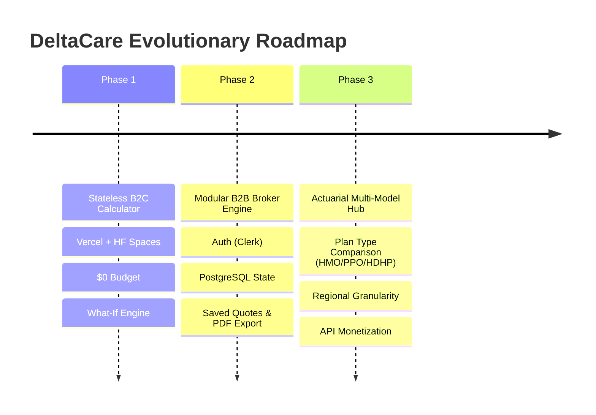

# Project Vision: DeltaCare

**Document Version**: 1.0.0  
**Phase**: Pre-Development Foundation Phase  
**Author**: Senior Product Manager & AI Governance Specialist  
**Status**: Baseline Reference  

---

## 1. Executive Summary & Product Philosophy

The health insurance industry has historically relied on **opacity as a business strategy**. By withholding price estimates until consumers surrender their phone numbers, email addresses, and personal identities, legacy providers optimize for aggressive sales conversion rather than user empowerment.

**DeltaCare's foundational philosophy is transparency through open intelligence**:
1. **Utility First**: An insurance estimate is an informational utility, not a lead-generation trap.
2. **Empowerment Through Transparency**: When consumers understand the direct mathematical link between health decisions (e.g., smoking cessation, weight management) and their insurance premiums, they are empowered both financially and clinically.
3. **Decoupled Simplicity**: Build small, robust, composable software. A micro-product that excels at a single high-value calculation is vastly superior to a bloated monolith.

---

## 2. Product Evolution Roadmap

---

## 3. Phase Details & Future Capabilities

### Phase 1: The Frictionless Consumer Calculator (Current Focus)
- Deliver an instant, completely anonymous B2C web tool.
- Validate model accuracy ($R^2 \ge 0.85$, $\text{MAE} \le \$2,000$), cold-start masking UX, and API responsiveness under free-tier constraints.
- Provide interactive "What-If" feedback that highlights the financial benefits of lifestyle modifications.

### Phase 2: The B2B Broker Platform (Modular Extension)
- **Zero Core Rewrite**: Because the Phase 1 backend is a decoupled, client-agnostic REST API, Phase 2 adds modular wrappers rather than refactoring the quoting engine.
- **Identity & Role-Based Access Control**: Integrate Clerk or AWS Cognito for broker authentication.
- **Relational Persistence**: Attach a managed relational database (e.g., Supabase / Neon PostgreSQL) to store broker accounts, client profiles, and historical quote comparisons.
- **Broker Workspace**: A dedicated dashboard allowing brokers to run side-by-side scenario modeling, batch-estimate client rosters, and export branded PDF estimates.

### Phase 3: Actuarial Multi-Model Intelligence (Long-Term Vision)
- **Multi-Plan Differentiation**: Expand beyond generic charges to predict specific plan types (Bronze, Silver, Gold, Platinum, HDHP vs. PPO).
- **Sub-Regional Actuarial Data**: Enrich predictions with state and county-level cost-of-living and healthcare density adjustments.
- **Developer API Gateway**: Expose authenticated, metered API access for third-party fintech and health-tech platforms to embed DeltaCare's quoting engine into their own workflows.

---

## 4. Product Sustainability & Long-Term Maintenance

- **Financial Sustainability**: Phase 1 incurs strictly \$0.00 operating expenses. Transitioning to Phase 2 can be self-funded through modest B2B subscription pricing for brokers before paid database tiers are required.
- **Model Maintainability**: The data ingestion and training pipeline is fully scripted. Retraining the pipeline against newer actuarial datasets requires running a single script to generate a new `model.joblib` artifact without altering the API runtime code.
- **AI-Agent Governance**: Standardized documentation, strict typing (Pydantic schemas), and modular decoupling ensure future AI coding agents can safely maintain, refactor, and extend the system without hallucinations or architectural drift.

