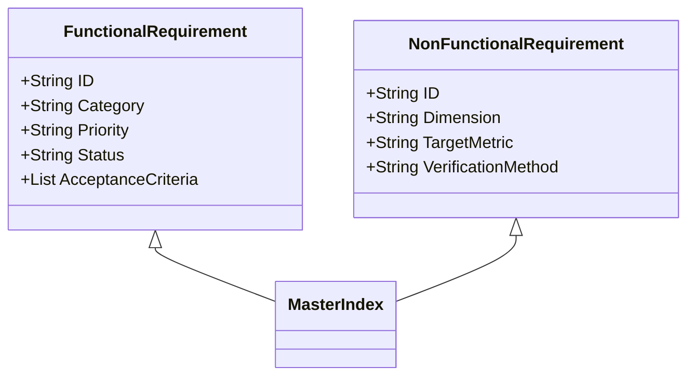

# Master Requirements Index: DeltaCare

**Document Version**: 1.0.0  
**Phase**: Pre-Development Foundation Phase  
**Author**: Senior Requirements Engineer & Product Manager  
**Status**: Baseline Reference  

---

## 1. Central Requirements Traceability Matrix

Every requirement in DeltaCare is assigned a permanent identifier (`FR-xxx` for functional, `NFR-xxx` for non-functional). Requirements trace directly to detailed specifications, acceptance criteria, and verification procedures.

---

## 2. Functional Requirements Registry

| Requirement ID | Category | Summary / Description | Priority | Target Phase | Traceability / Details |
| :--- | :--- | :--- | :--- | :--- | :--- |
| **FR-001** | Data Pipeline | Scriptable automated ingestion of US `insurance.csv` | High | Phase 1 | [FUNCTIONAL_REQUIREMENTS.md#fr-001](file:///e:/DeltaCare/docs/FUNCTIONAL_REQUIREMENTS.md#fr-001) |
| **FR-002** | ML Model | Train tree ensemble regressor capturing BMI $\times$ smoker interactions | Critical | Phase 1 | [FUNCTIONAL_REQUIREMENTS.md#fr-002](file:///e:/DeltaCare/docs/FUNCTIONAL_REQUIREMENTS.md#fr-002) |
| **FR-003** | ML Packaging | Export unified `sklearn.pipeline.Pipeline` to `model.joblib` | Critical | Phase 1 | [FUNCTIONAL_REQUIREMENTS.md#fr-003](file:///e:/DeltaCare/docs/FUNCTIONAL_REQUIREMENTS.md#fr-003) |
| **FR-004** | API Core | Health check endpoint `GET /health` | Medium | Phase 1 | [FUNCTIONAL_REQUIREMENTS.md#fr-004](file:///e:/DeltaCare/docs/FUNCTIONAL_REQUIREMENTS.md#fr-004) |
| **FR-005** | API Core | Stateless prediction endpoint `POST /predict` with schema validation | Critical | Phase 1 | [FUNCTIONAL_REQUIREMENTS.md#fr-005](file:///e:/DeltaCare/docs/FUNCTIONAL_REQUIREMENTS.md#fr-005) |
| **FR-006** | API Business Logic | Mathematical floor guardrail preventing negative premiums | High | Phase 1 | [FUNCTIONAL_REQUIREMENTS.md#fr-006](file:///e:/DeltaCare/docs/FUNCTIONAL_REQUIREMENTS.md#fr-006) |
| **FR-007** | Frontend UI | Single-screen 6-input actuarial capture form | Critical | Phase 1 | [FUNCTIONAL_REQUIREMENTS.md#fr-007](file:///e:/DeltaCare/docs/FUNCTIONAL_REQUIREMENTS.md#fr-007) |
| **FR-008** | Frontend UX | Dual metric display: Monthly hero metric with Annual subtitle | High | Phase 1 | [FUNCTIONAL_REQUIREMENTS.md#fr-008](file:///e:/DeltaCare/docs/FUNCTIONAL_REQUIREMENTS.md#fr-008) |
| **FR-009** | Frontend UX | Statistical confidence range rendering ($\pm \text{MAE}$) | High | Phase 1 | [FUNCTIONAL_REQUIREMENTS.md#fr-009](file:///e:/DeltaCare/docs/FUNCTIONAL_REQUIREMENTS.md#fr-009) |
| **FR-010** | Frontend UX | Dynamic What-If smoking cessation savings delta badge | High | Phase 1 | [FUNCTIONAL_REQUIREMENTS.md#fr-010](file:///e:/DeltaCare/docs/FUNCTIONAL_REQUIREMENTS.md#fr-010) |
| **FR-011** | Frontend UX | Debounced BMI interactive slider (300–500ms debounce) | Medium | Phase 1 | [FUNCTIONAL_REQUIREMENTS.md#fr-011](file:///e:/DeltaCare/docs/FUNCTIONAL_REQUIREMENTS.md#fr-011) |
| **FR-012** | Frontend UX | Multi-stage cold-start loading states (0–2s, 3–10s, 20s timeout) | High | Phase 1 | [FUNCTIONAL_REQUIREMENTS.md#fr-012](file:///e:/DeltaCare/docs/FUNCTIONAL_REQUIREMENTS.md#fr-012) |
| **FR-013** | Compliance | Legal non-binder underwriting disclaimer positioned beneath quote | Critical | Phase 1 | [FUNCTIONAL_REQUIREMENTS.md#fr-013](file:///e:/DeltaCare/docs/FUNCTIONAL_REQUIREMENTS.md#fr-013) |

---

## 3. Non-Functional Requirements Registry

| Requirement ID | Dimension | Target Metric / Standard | Priority | Status | Traceability / Details |
| :--- | :--- | :--- | :--- | :--- | :--- |
| **NFR-001** | Hosting Cost | Perpetual **$0.00** total infrastructure spend | Critical | Confirmed | [NON_FUNCTIONAL_REQUIREMENTS.md#nfr-001](file:///e:/DeltaCare/docs/NON_FUNCTIONAL_REQUIREMENTS.md#nfr-001) |
| **NFR-002** | Model Accuracy | $R^2 \ge 0.85$ on holdout test set | High | Confirmed | [NON_FUNCTIONAL_REQUIREMENTS.md#nfr-002](file:///e:/DeltaCare/docs/NON_FUNCTIONAL_REQUIREMENTS.md#nfr-002) |
| **NFR-003** | Model Error | Mean Absolute Error ($\text{MAE}$) $\le \$2,000$ | High | Confirmed | [NON_FUNCTIONAL_REQUIREMENTS.md#nfr-003](file:///e:/DeltaCare/docs/NON_FUNCTIONAL_REQUIREMENTS.md#nfr-003) |
| **NFR-004** | Inference Latency | Active server processing $\le 100\text{ms}$ | High | Confirmed | [NON_FUNCTIONAL_REQUIREMENTS.md#nfr-004](file:///e:/DeltaCare/docs/NON_FUNCTIONAL_REQUIREMENTS.md#nfr-004) |
| **NFR-005** | API Rate Limiting | In-memory token bucket: Max 60 req/min per IP | Critical | Confirmed | [NON_FUNCTIONAL_REQUIREMENTS.md#nfr-005](file:///e:/DeltaCare/docs/NON_FUNCTIONAL_REQUIREMENTS.md#nfr-005) |
| **NFR-006** | CORS Security | Restrict to Vercel production origin + localhost | Critical | Confirmed | [NON_FUNCTIONAL_REQUIREMENTS.md#nfr-006](file:///e:/DeltaCare/docs/NON_FUNCTIONAL_REQUIREMENTS.md#nfr-006) |
| **NFR-007** | Privacy & PII | 0% PII persistence; strictly stateless API execution | Critical | Confirmed | [NON_FUNCTIONAL_REQUIREMENTS.md#nfr-007](file:///e:/DeltaCare/docs/NON_FUNCTIONAL_REQUIREMENTS.md#nfr-007) |
| **NFR-008** | Memory Footprint | Max container memory $\le 2\text{GB}$ (fits 16GB HF limit) | High | Confirmed | [NON_FUNCTIONAL_REQUIREMENTS.md#nfr-008](file:///e:/DeltaCare/docs/NON_FUNCTIONAL_REQUIREMENTS.md#nfr-008) |
| **NFR-009** | Cold-Start Pre-Warm | Non-blocking optimistic `GET /health` on initial page mount | Medium | Confirmed | [NON_FUNCTIONAL_REQUIREMENTS.md#nfr-009](file:///e:/DeltaCare/docs/NON_FUNCTIONAL_REQUIREMENTS.md#nfr-009) |
| **NFR-010** | Train-Serve Parity | 100% preprocessing parity via unified pipeline artifact | Critical | Confirmed | [NON_FUNCTIONAL_REQUIREMENTS.md#nfr-010](file:///e:/DeltaCare/docs/NON_FUNCTIONAL_REQUIREMENTS.md#nfr-010) |
| **NFR-011** | Cross-Browser | Functional parity across Chrome, Firefox, Safari, Edge, Mobile | High | Confirmed | [NON_FUNCTIONAL_REQUIREMENTS.md#nfr-011](file:///e:/DeltaCare/docs/NON_FUNCTIONAL_REQUIREMENTS.md#nfr-011) |

