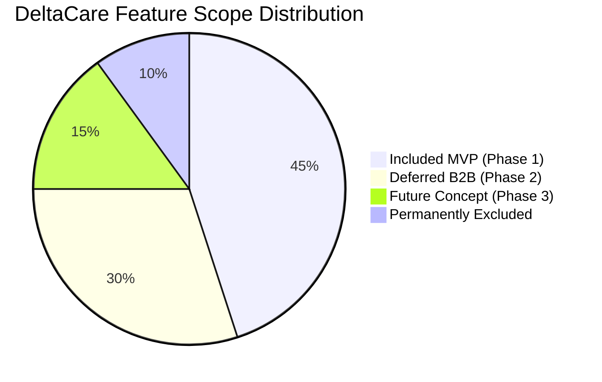

# Project Scope: DeltaCare

**Document Version**: 1.0.0  
**Phase**: Pre-Development Foundation Phase  
**Author**: Senior Requirements Engineer & Product Manager  
**Status**: Baseline Reference  

---

## 1. Scope Boundary Overview

To ensure strict engineering discipline, prevent scope creep, and preserve the $0 perpetual budget model, project capabilities are categorized into four distinct boundaries:
1. **Included Functionality (Phase 1 MVP)**: Delivered and validated immediately.
2. **Excluded Functionality (Phase 1)**: Intentionally prohibited from Phase 1.
3. **Deferred Functionality (Phase 2)**: Architecturally planned for subsequent B2B release.
4. **Future Functionality (Phase 3+)**: Long-term conceptual roadmap.

---

## 2. Detailed Scope Breakdown

### 2.1 Included Functionality (Phase 1 MVP)

- **Actuarial Input Ingestion**:
  - Validated capture of `age` (integer: 18–100).
  - Validated capture of `sex` (enum: `male`, `female`).
  - Validated capture of `bmi` (float: 10.0–60.0) with bidirectional slider and numeric sync.
  - Validated capture of `children` (integer: 0–10).
  - Validated capture of `smoker` (boolean/enum: `yes`, `no`).
  - Validated capture of `region` (enum: `northeast`, `southeast`, `southwest`, `northwest`).
- **Machine Learning Quoting Engine**:
  - Scripted data ingestion from authoritative mirror of US `insurance.csv`.
  - Feature encoding and scaling via `ColumnTransformer`.
  - Tree ensemble regressor (XGBoost/LightGBM) capturing non-linear interaction terms.
  - Export of unified `model.joblib` artifact.
  - Evaluation reporting $R^2$ and MAE metrics against holdout data.
- **Backend API (`FastAPI`)**:
  - `GET /health` transactional health check.
  - `POST /predict` stateless quoting route accepting validated JSON payload.
  - Mathematical post-prediction floor guardrail (enforcing non-negative quotes).
  - In-memory rate limiting (`slowapi`: 60 requests/min per IP).
  - Strict CORS origin whitelisting (Vercel production domain + `localhost:3000`).
  - Dockerized container packaging for Hugging Face Spaces deployment.
- **Frontend Client (`Next.js` / React + Tailwind CSS)**:
  - Responsive single-view calculator interface.
  - Primary hero metric: Estimated Monthly Premium (`predicted / 12`).
  - Secondary metric: Estimated Annual Premium.
  - Statistical confidence range bracket ($\pm \text{MAE}$).
  - Dynamic "What-If" smoking delta badge (instant savings quantification).
  - Debounced BMI slider (300–500ms debounce interval).
  - Optimistic background `GET /health` pre-warming on initial page load.
  - 3-tier cold-start UX loading transitions (Spinner $\rightarrow$ Skeleton Wakeup $\rightarrow$ 20s Timeout Guard).
  - Embedded non-binder legal disclaimer directly beneath quote card.

---

### 2.2 Excluded Functionality (Phase 1 MVP)

- **User Accounts & Identity**: No user registration, passwords, social logins, JWT tokens, or session cookies.
- **Data Persistence**: Zero persistent databases (SQL/NoSQL); zero storage of user-submitted actuarial profiles.
- **Payment Processing**: No credit card collection, payment gateways (Stripe/PayPal), or subscription billing.
- **Policy Underwriting & Issuance**: No formal policy generation, electronic signatures, or binding insurance contracts.
- **Multi-Plan Differentiation**: No breakdown between HMO, PPO, EPO, or catastrophic plan tiers.
- **PII Harvesting**: Zero fields for name, physical address, email address, or phone number.

---

### 2.3 Deferred Functionality (Phase 2 — B2B Expansion)

- **Broker Authentication**: Integration of Clerk or AWS Cognito for broker accounts.
- **Relational Persistence**: PostgreSQL database mapping brokers, clients, and saved quotes.
- **Broker Dashboard**: Gated agency portal to save, search, and manage client quote records.
- **PDF Generation**: Downloadable, agency-branded PDF quote summaries.
- **Side-by-Side Scenario Modeling**: Broker interface to compare multiple client health scenarios simultaneously.

---

### 2.4 Future Functionality (Phase 3+ — Long-Term Concept)

- State- and county-level geospatial healthcare cost adjustments.
- Public developer API with API key provisioning and rate-metered billing.
- Prescription drug formulary cost modeling.
- Direct insurance carrier API integrations for electronic plan handoff.

