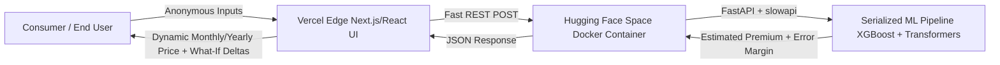

# STAGE 01 — PROJECT DISCOVERY DELIVERABLE: DELTACARE

**Document Version**: 1.0.0  
**Phase**: Pre-Development Foundation Phase  
**Project Name**: DeltaCare  
**Primary Repository**: `DeltaCare`  
**Workspace Location**: `e:\DeltaCare`  
**Status**: Approved by Technical Lead  

---

## 1. Project Overview

**DeltaCare** is a transparent, data-driven health insurance premium prediction SaaS micro-product designed to eliminate the friction, opacity, and invasive sales tactics typical of traditional health insurance quoting.

Unlike legacy platforms that require personally identifiable information (PII), email addresses, and phone numbers before handing users over to aggressive sales funnels, DeltaCare provides instant, anonymous, and statistically backed premium estimates based on standard actuarial inputs.



---

## 2. Problem Statement

### 2.1 The Consumer Pain Point
- **Information Asymmetry & Opacity**: Consumers cannot easily see how personal lifestyle factors (such as BMI or tobacco use) directly affect insurance premiums.
- **Invasive Data Harvesting**: Traditional quoting platforms force users to surrender sensitive contact details, resulting in unwanted sales agent harassment.
- **Delayed Feedback**: Quoting is often manual, slow, and full of friction.

### 2.2 The Business & Broker Pain Point
- **High Inefficient Underwriting Costs**: Initial ballparking consumes costly human broker and underwriter hours.
- **Lead Abandonment**: High-intent potential policyholders bounce before completing long-winded multi-page questionnaires.

---

## 3. Project Objectives

1. **Instant Quoting**: Deliver predictions within sub-second latencies (excluding cold-starts).
2. **Stateless Privacy**: Zero persistent PII storage in Phase 1 (no databases, no accounts, no session tracking).
3. **Actionable Transparency**: Provide dynamic "What-If" lifestyle impact insights (e.g., smoking cessation delta savings, debounced BMI sliders).
4. **Strict $0 Perpetual Operating Cost**: Host the entire decoupled architecture permanently on reliable free tiers without out-of-memory (OOM) failures or surprise cloud charges.
5. **Decoupled Future-Proofing**: Establish a clean REST API foundation capable of seamless expansion into a B2B broker platform in Phase 2.

---

## 4. Target Audience & Personas

### Primary Persona (Phase 1 — B2C)
- **The Self-Directed Health Plan Shopper**:
  - Wants a ballpark cost estimation before entering the formal insurance market.
  - Demands total privacy and refuses to provide phone or email.
  - Wants to understand the financial consequences of lifestyle choices (e.g., quitting smoking or losing weight).

### Secondary Persona (Phase 2 — B2B Extension)
- **The Independent Insurance Broker / Agency**:
  - Needs rapid, automated pre-underwriting quoting utilities.
  - Requires persistent client records, saved quotes, and exportable estimates.

---

## 5. Core Value Proposition

| Traditional Insurance Quoting | DeltaCare Approach |
| :--- | :--- |
| Requires Email, Phone, Full Name | 100% Anonymous (Stateless inputs) |
| Days/Hours of delay for sales contact | Instant real-time calculation |
| Static, mysterious black-box price | Dynamic What-If analysis (Smoking delta, BMI slider) |
| Hard point estimate implying false guarantee | Statistically sound confidence range ($RMSE/MAE$-based) |
| Heavy, complex multi-step application forms | Sleek 6-field single-screen interface |

---

## 6. Proposed Feature Inventory

### 6.1 Phase 1 (MVP — In Scope)
- **Actuarial Input Engine**:
  - `age`: Integer (18–100)
  - `sex`: Categorical (`male`, `female`)
  - `bmi`: Float (10.0–60.0) with interactive slider and number input
  - `children`: Integer count of dependents (0–10)
  - `smoker`: Binary toggle (`yes`, `no`)
  - `region`: Categorical select (`northeast`, `southeast`, `southwest`, `northwest`)
- **Dual Metric Price Presentation**:
  - Primary Hero Metric: Monthly Estimate ($\text{Annual} / 12$)
  - Secondary Metric: Total Estimated Annual Charges
- **Statistical Confidence Range**:
  - Displays dynamic bracket (e.g., "$340 – $385 / mo") based on model validation error margin ($MAE$).
- **Dynamic What-If Engine**:
  - *Smoking Cessation Badge*: Computes automated delta against a synthetic non-smoker baseline with a clear financial savings callout.
  - *Debounced BMI Exploration*: Smooth slider adjustment (300–500ms debounce) providing immediate price adjustments.
- **Cold-Start UX Guardrails**:
  - Optimistic background pre-warming via non-blocking `GET /health` on initial page load.
  - Tiered loading states: 0–2s spinner $\rightarrow$ 3–10s skeleton wake-up message $\rightarrow$ 20s graceful timeout recovery.
- **Prominent Underwriting Disclaimer**:
  - Legally protective, non-intrusive disclaimer placed directly under the result card.

### 6.2 Phase 2 (Future Extension — Explicitly Out of Scope for Phase 1)
- User Authentication (Clerk / Auth0 / AWS Cognito).
- Persistent Relational Database (PostgreSQL / Supabase / Neon).
- Broker Dashboard & Client Management.
- PDF Export and formal quote binding.

---

## 7. User Roles & Permissions

- **Anonymous Public Visitor (Phase 1)**:
  - Can access the web UI.
  - Can submit prediction requests subject to rate limiting (60 req/min).
  - Cannot access historical data (stateless).
- **System / API Consumer (Phase 1)**:
  - Can execute `GET /health`.
  - Can execute `POST /predict` with compliant JSON schema.

---

## 8. Functional Specifications

### 8.1 API Contract (`DeltaCare` API Service)

#### Health Check
- **Route**: `GET /health`
- **Response**: `200 OK`
```json
{
  "status": "healthy",
  "version": "1.0.0"
}
```

#### Quoting Endpoint
- **Route**: `POST /predict`
- **Request Payload**:
```json
{
  "age": 35,
  "sex": "male",
  "bmi": 28.5,
  "children": 2,
  "smoker": "no",
  "region": "northwest"
}
```
- **Response Payload**:
```json
{
  "predicted_annual": 4350.00,
  "predicted_monthly": 362.50,
  "confidence_margin_annual": 1950.00,
  "confidence_margin_monthly": 162.50,
  "range_annual": [2400.00, 6300.00],
  "range_monthly": [200.00, 525.00],
  "currency": "USD"
}
```

### 8.2 Machine Learning Pipeline Specification
- **Dataset**: `insurance.csv` (1,338 US health insurance beneficiary records).
- **Algorithm**: Tree Ensemble Regressor (XGBoost / LightGBM) to capture non-linear interaction terms (`bmi` $\times$ `smoker`).
- **Explainability**: SHAP analysis during training to validate feature importances and back UI What-If rules.
- **Preprocessing & Serialization**: Unified `sklearn.pipeline.Pipeline` holding:
  - `ColumnTransformer`: `StandardScaler` for numericals, `OneHotEncoder` for categoricals.
  - Regressor: `XGBRegressor`.
  - Serialized via `joblib` into `model.joblib`.
- **Validation Gates**:
  - $R^2 \ge 0.85$
  - $\text{MAE} \le \$2,000$ (equivalent to $\le \$166/\text{month}$)
- **Inference Guardrails**: Post-prediction floor logic enforcing non-negative predictions above legal catastrophic minimums.

---

## 9. Non-Functional Specifications

- **Latency**: Sub-100ms inference processing once container is active.
- **Availability / Warmth**: Optimistic background wake-up ping (`GET /health`) triggered upon web form load.
- **Rate Limiting**: In-memory token bucket (`slowapi`) enforcing a maximum of 60 requests/minute per client IP (HTTP 429 on breach).
- **CORS Protection**: Restricted to the Vercel production frontend origin and local dev environment.
- **Scalability**: Zero-cost horizontal scale-out for static frontend via Vercel Edge CDN; 16GB RAM overhead margin on Hugging Face Spaces preventing all OOM exceptions.

---

## 10. Constraints & The Strict $0 Budget Architecture

| Component | Selected Technology | Tier / Host | Cost | Justification |
| :--- | :--- | :--- | :--- | :--- |
| **Frontend UI** | Next.js / React + Tailwind CSS | Vercel | **$0.00** | Perpetual free tier, edge CDN, zero-sleep, automatic SSL. |
| **Backend API** | FastAPI + slowapi + Docker | Hugging Face Spaces | **$0.00** | 16GB RAM / 2 vCPUs free CPU tier. Prevents 512MB RAM OOM crashes seen on Render/Fly.io. |
| **Storage / DB** | Stateless (In-Memory Pipeline) | None | **$0.00** | No database overhead required for Phase 1. |
| **Model Ingestion** | Raw Mirror / Kaggle CLI | GitHub Actions / Local | **$0.00** | Deterministic scriptable ingestion. |
| **Total Cloud Spend** | | | **$0.00** | 100% Free perpetual operation with zero credit cards required. |

---

## 11. Risk Analysis & Mitigation Matrix

| Risk Identified | Severity | Mitigation Strategy |
| :--- | :--- | :--- |
| **Hugging Face Cold Starts (15–20s)** | High | Frontend fires non-blocking `GET /health` immediately on initial page mount. 3-stage visual progress states (Spinner $\rightarrow$ Skeleton Wakeup $\rightarrow$ 20s Retry Guard). |
| **Train-Serve Data Leak / Skew** | High | Single serialized `sklearn.pipeline.Pipeline` (`model.joblib`) executing both `ColumnTransformer` and regressor inside a single call. |
| **Scraping / API Exhaustion** | Medium | Strict CORS domain whitelisting combined with `slowapi` 60 req/min in-memory rate limiting. |
| **Legal / Underwriting Liability** | Medium | Prominently displayed explicit non-binder disclaimer rendered right under the quote card. |
| **RAM Exhaustion during Pandas/ML Loading** | High | Bypassed 512MB limits by deploying to Hugging Face Spaces offering 16GB free RAM. |

---

## 12. Approved Decisions

1. **Project & Repository Name**: `DeltaCare`.
2. **Authoritative Location**: `e:\DeltaCare`.
3. **Repository Architecture**: Unified repository umbrella `DeltaCare` containing modular service boundaries for API and Frontend (`apps/api` or `backend`, `apps/web` or `frontend`), capable of single-source documentation and isolated deployments.

---

## 13. Next Steps

With Stage 01 formally approved:
1. Advance to **Stage 02: Architecture & System Design Documentation**.
2. Author detailed architecture specifications, system topology, and Architecture Decision Records (ADRs) directly in `e:\DeltaCare\docs`.

