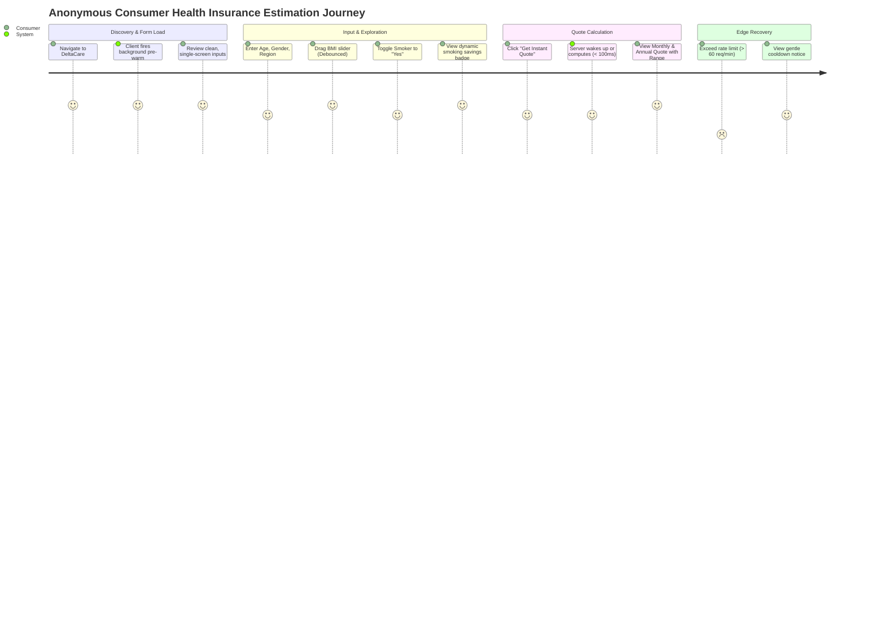

# User Journeys: DeltaCare

**Document Version**: 1.0.0  
**Phase**: Pre-Development Foundation Phase  
**Author**: Senior Requirements Engineer & Product Manager  
**Status**: Baseline Reference  

---

## 1. Journey Map Overview

This document specifies the primary and alternative paths an anonymous user takes when interacting with DeltaCare, including cold-start handling and edge-case recoveries.

---

## 2. Primary Journey: Standard Quoting Flow (Warm Server)

1. **Arrival**: The consumer navigates to the public Vercel URL (`https://deltacare.vercel.app`).
2. **Silent Pre-warming**: The client mounts and immediately dispatches a non-blocking `GET /health` request to Hugging Face Spaces in the background. The consumer is unaware of this network call.
3. **Data Entry**: The consumer enters their actuarial profile:
   - Age: `42`
   - Gender: `Female`
   - BMI: `26.4`
   - Dependents: `1`
   - Smoker: `No`
   - Region: `Northwest`
4. **Submission**: The consumer clicks the primary call-to-action button: **"Get Instant Quote"**.
5. **State Feedback**:
   - The button disables immediately.
   - Text updates to *"Calculating..."* with an inline spinner.
6. **Inference Execution**: The active FastAPI container receives the payload, validates schema via Pydantic, applies the unified pipeline, applies the floor guardrail, and returns the response in $< 100\text{ms}$.
7. **Result Presentation**:
   - The UI smoothly scrolls/focuses to the Results Card.
   - **Primary Metric**: **$485.00 / mo** (bold, high-contrast typography).
   - **Secondary Metric**: *Estimated Annual: $5,820.00*.
   - **Confidence Range**: *$420.00 – $550.00 / mo*.
   - **Disclaimer**: Legible non-binder notice visible directly beneath.

---

## 3. Alternative Journey A: Cold-Start Server Spin-Up Flow

1. **Context**: The consumer visits the application after 48+ hours of platform dormancy. The Hugging Face container is in a sleeping state.
2. **Initial Trigger**: The consumer fills out the form quickly and clicks **"Get Instant Quote"** before the background pre-warm request has fully booted the container.
3. **Stage 1 (0–2s)**: The submit button displays the standard inline spinner: *"Calculating..."*.
4. **Stage 2 (3–10s)**: The API call has not yet resolved. The client transitions UI state:
   - The quote result area renders a pulsating skeleton loader.
   - A friendly status message appears: *"Waking up the pricing engine... (this takes a few seconds)"*.
   - The user understands the delay is intentional infrastructure warm-up rather than a site freeze.
5. **Resolution (12–15s)**: The container finishes spinning up, executes the prediction, and returns HTTP 200.
6. **Display**: The skeleton loader fades into the final calculated quote card.

---

## 4. Alternative Journey B: "What-If" Lifestyle Exploration

1. **Trigger**: An existing smoker enters their details with `smoker: yes`.
2. **Savings Badge Activation**:
   - The client dispatches a secondary calculation with `smoker: no`.
   - The calculated delta reveals a substantial cost disparity (e.g., ~$3,200/year).
   - A prominent savings badge animates onto the screen: *"Quitting smoking could save you ~$3,200/year ($266/month)"*.
3. **BMI Slider Dragging**:
   - The user drags the BMI slider downward from `34.0` (Obese) to `24.5` (Normal).
   - The client applies a 400ms debounce window.
   - As the slider pauses, the updated price dynamically adjusts on screen, showing the immediate financial benefit of weight loss.

---

## 5. Failure Journey: Timeout & Recovery

1. **Context**: Hugging Face Spaces experiences an infrastructure hang or network partition lasting $> 20$ seconds.
2. **Intervention**: The client-side `AbortController` trips at the 20-second threshold.
3. **Feedback**: The client aborts the pending fetch request and displays a clear recovery card:
   - *"Our servers are warming up. Please click calculate again."*
   - A prominent **"Retry"** button is displayed.
4. **Recovery**: Clicking "Retry" dispatches a fresh request against the now-awake container, resolving cleanly.

---

## 6. Abuse Journey: Rate-Limit Cooldown

1. **Context**: A user repeatedly clicks calculate or scrubs the slider beyond the allowed threshold, generating $> 60$ requests within 60 seconds.
2. **Enforcement**: FastAPI `slowapi` returns `HTTP 429 Too Many Requests`.
3. **Client Handling**: The client intercepts HTTP 429 and displays a temporary notification banner:
   - *"Calculation limit reached. Please wait a moment before recalculating."*
   - The submit button is temporarily disabled with a 15-second countdown timer.

