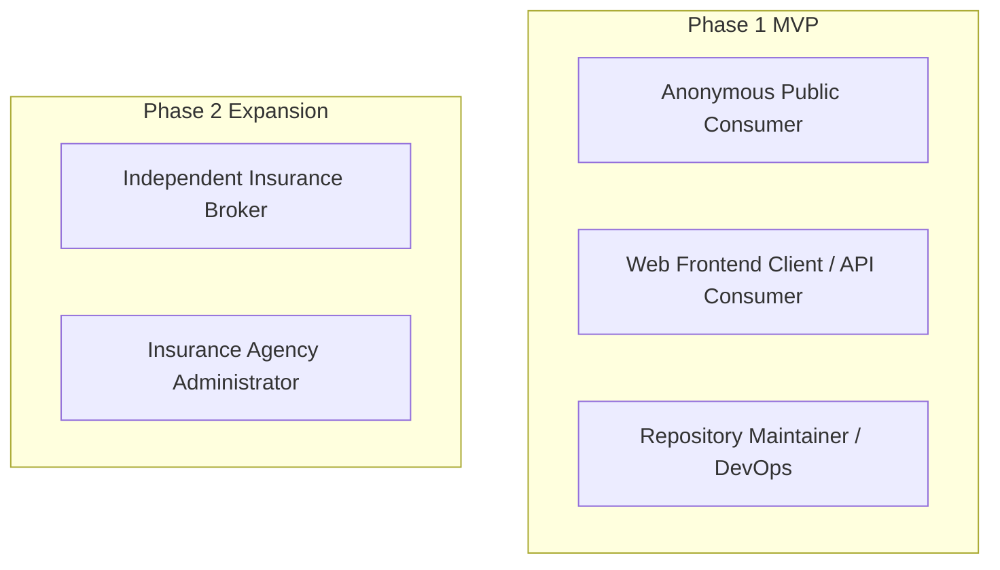

# User Roles: DeltaCare

**Document Version**: 1.0.0  
**Phase**: Pre-Development Foundation Phase  
**Author**: Senior Requirements Engineer & Product Manager  
**Status**: Baseline Reference  

---

## 1. Actor Hierarchy Overview

DeltaCare distinguishes between active roles in **Phase 1 (MVP)** and deferred roles planned for **Phase 2 (B2B Expansion)**.

---

## 2. Phase 1 Roles (Active)

### 2.1 Role: Anonymous Public Consumer (Primary Actor)
- **Profile**: Any individual visiting the web application seeking an immediate health insurance price estimate.
- **Motivations**:
  - Wants a ballpark price before shopping on official health insurance exchanges.
  - Wants to understand the financial implications of smoking cessation or BMI reduction.
  - Refuses to surrender phone numbers or email addresses to avoid broker sales harassment.
- **Capabilities**:
  - Load the single-page application without authentication.
  - Enter demographic and health attributes (Age, Gender, BMI, Dependents, Smoker status, Region).
  - Interact with the debounced BMI slider to observe real-time cost changes.
  - View calculated monthly and yearly estimated premiums and confidence intervals.
  - View the What-If smoking savings delta badge.
  - Read the non-binder underwriting disclaimer.
- **Restrictions**:
  - Subject to client IP rate limits (60 requests/minute).
  - Cannot save quotes, access history, or export accounts (stateless).

### 2.2 Role: Web Client / API Consumer (System Actor)
- **Profile**: The browser execution runtime running the Next.js/React single-page application.
- **Capabilities**:
  - Issue non-blocking `GET /health` pre-warming ping on page mount.
  - Dispatch schema-compliant `POST /predict` requests to the FastAPI backend.
  - Manage UI timer states for cold-start progress masking (0–2s, 3–10s, 20s timeout).
- **Restrictions**:
  - Bound by CORS origin restrictions.
  - Requests rejected if payload fails Pydantic schema validation.

### 2.3 Role: Repository Maintainer / DevOps Engineer (Administrative Actor)
- **Profile**: The technical lead or AI coding agent responsible for repository integrity, CI/CD pipelines, and hosting configuration.
- **Capabilities**:
  - Trigger model retraining and artifact re-generation scripts.
  - Build and deploy Docker containers to Hugging Face Spaces.
  - Deploy frontend updates to Vercel.
  - Inspect server health, resource consumption, and error rates.

---

## 3. Phase 2 Roles (Deferred B2B Expansion)

### 3.1 Role: Independent Insurance Broker (Deferred)
- **Profile**: A licensed health insurance agent using DeltaCare as a preliminary underwriting and estimating utility for client consultations.
- **Intended Capabilities**:
  - Secure login via authentication provider (Clerk / Cognito).
  - Create and manage persistent client profiles.
  - Save, tag, and organize historical quote estimates.
  - Generate co-branded PDF quote summaries to share with prospects.

### 3.2 Role: Agency Administrator (Deferred)
- **Profile**: An agency manager overseeing a team of brokers.
- **Intended Capabilities**:
  - Manage broker seats and permissions.
  - View aggregate quoting volume and lead metrics across the agency.

