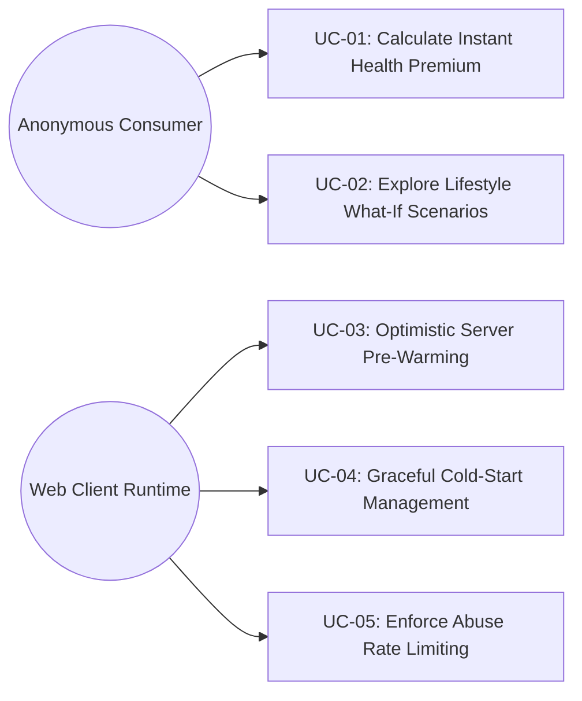

# Use Cases: DeltaCare

**Document Version**: 1.0.0  
**Phase**: Pre-Development Foundation Phase  
**Author**: Senior Requirements Engineer & Product Manager  
**Status**: Baseline Reference  

---

## 1. Use Case Diagram

---

## 2. Detailed Use Case Specifications

### UC-01: Calculate Instant Health Premium
- **Primary Actor**: Anonymous Consumer
- **Goal**: Receive an instant, statistically sound health insurance premium estimate.
- **Preconditions**: Web application is loaded in a supported browser.
- **Main Success Scenario**:
  1. Consumer fills out the 6 actuarial fields: Age, Sex, BMI, Children, Smoker toggle, Region.
  2. Consumer clicks "Get Instant Quote".
  3. Client validates inputs locally.
  4. Client dispatches `POST /predict` with JSON payload.
  5. Backend passes payload through serialized `model.joblib` pipeline.
  6. Backend enforces non-negative floor guardrail.
  7. Backend returns predicted annual charges, monthly charges, and confidence margin.
  8. Client displays primary monthly estimate, annual estimate, and confidence range with legal disclaimer.
- **Postconditions**: User receives the calculated quote; zero personal data is persisted on the server.

---

### UC-02: Explore Lifestyle What-If Scenarios
- **Primary Actor**: Anonymous Consumer
- **Goal**: Quantify the financial savings resulting from lifestyle modifications (smoking cessation, BMI reduction).
- **Preconditions**: User has loaded the calculator and entered initial values.
- **Main Success Scenario (Smoking Delta)**:
  1. Consumer sets `smoker: yes`.
  2. Client issues a secondary query setting `smoker: no` with identical demographic attributes.
  3. Client calculates the delta: $\text{Delta} = \text{Quote}_{\text{smoker}} - \text{Quote}_{\text{non-smoker}}$.
  4. Client renders the What-If savings badge with annualized and monthly savings.
- **Main Success Scenario (BMI Exploration)**:
  1. Consumer drags the interactive BMI slider.
  2. Client debounces events at 400ms.
  3. Client updates the prediction asynchronously as the user pauses dragging.
  4. Dynamic quote updates in real time.

---

### UC-03: Optimistic Server Pre-Warming
- **Primary Actor**: Web Client Runtime (Automated System Actor)
- **Goal**: Trigger container spin-up on Hugging Face Spaces during dormant periods before the user clicks submit.
- **Preconditions**: Web application mounts in browser DOM.
- **Main Success Scenario**:
  1. Browser executes component mounting lifecycle.
  2. Client dispatches non-blocking `GET /health` to the backend.
  3. Hugging Face Spaces receives the request and initializes the Docker container if dormant.
  4. Backend returns HTTP 200 `{"status": "healthy"}`.
- **Extensions**: If the request fails or times out, the client logs a silent console debug message without interrupting the user.

---

### UC-04: Graceful Cold-Start Management
- **Primary Actor**: Web Client Runtime
- **Goal**: Provide transparent, calming visual feedback if the backend container is spinning up.
- **Preconditions**: User clicked "Get Instant Quote" while backend container is booting.
- **Main Success Scenario**:
  1. Client sends `POST /predict` and starts an internal timer.
  2. For $t < 2\text{s}$, client renders an inline button spinner.
  3. For $2\text{s} \le t \le 10\text{s}$, client transitions to a pulsating skeleton loader with text *"Waking up the pricing engine... (this takes a few seconds)"*.
  4. At $t \approx 12\text{s}$, backend responds with HTTP 200.
  5. Client replaces skeleton loader with the rendered quote card.
- **Extensions**: At $t = 20\text{s}$, client triggers an `AbortController` timeout and prompts the user to retry.

---

### UC-05: Enforce Abuse Rate Limiting
- **Primary Actor**: Web Client Runtime & FastAPI Gateway
- **Goal**: Protect the free-tier backend instance from automated scraping or flood attacks.
- **Preconditions**: A client IP submits requests to `/predict`.
- **Main Success Scenario**:
  1. Client sends request within the 60 requests/minute limit.
  2. Backend updates in-memory token bucket and processes request normally.
- **Exception Scenario (Limit Exceeded)**:
  1. Client sends the 61st request within a 60-second window.
  2. `slowapi` rejects request with `HTTP 429 Too Many Requests`.
  3. Client intercepts HTTP 429 and shows temporary cooldown notice: *"Please wait a moment before recalculating."*

