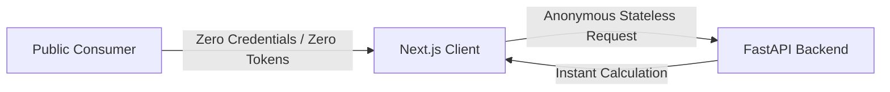
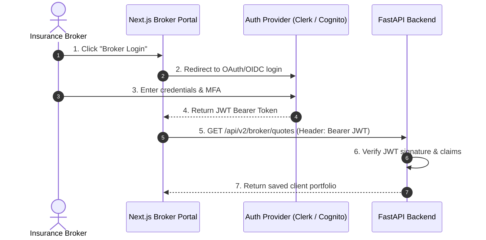

# Authentication Flow: DeltaCare

**Document Version**: 1.0.0  
**Phase**: Pre-Development Foundation Phase  
**Author**: Senior Security Architect  
**Status**: Authoritative Architectural Baseline  
**Approved References**: [ADR-004](../decisions/004-stateless-b2c-mvp.md)

---

## 1. Phase 1 Architecture: Public Anonymous Model (Zero Authentication)

In Phase 1 (MVP), **DeltaCare deliberately enforces NO AUTHENTICATION**.



### 1.1 Architectural Rationale
- **Core Value Proposition**: The entire mission of DeltaCare is to dismantle the invasive lead-generation model of traditional health insurance quoting. Forcing users to create accounts or authenticate defeats the primary user value.
- **Budget & Hosting Feasibility**: Identity providers (e.g., Auth0, Firebase Auth) introduce external dependencies and potential billing tiers.
- **Privacy Immunity**: Having zero user credentials or session tokens eliminates credential-stuffing attacks, password breach liabilities, and session hijacking vectors.

---

## 2. Phase 2 Architecture: Planned Broker Authentication (B2B Expansion)

When transitioning to Phase 2 (B2B Broker Portal), an authentication boundary will be introduced exclusively for licensed brokers:



### 2.1 Forward-Compatible Architectural Design
Because the Phase 1 backend is a decoupled, client-agnostic REST API, adding authentication in Phase 2 requires **zero modification to the core ML calculation engine**. It will be implemented cleanly as a FastAPI dependency:

```python
# Conceptual Phase 2 Auth Dependency (Deferred)
async def verify_broker_token(token: str = Depends(oauth2_scheme)):
    # Validates JWT signature and role claims
    ...
```

