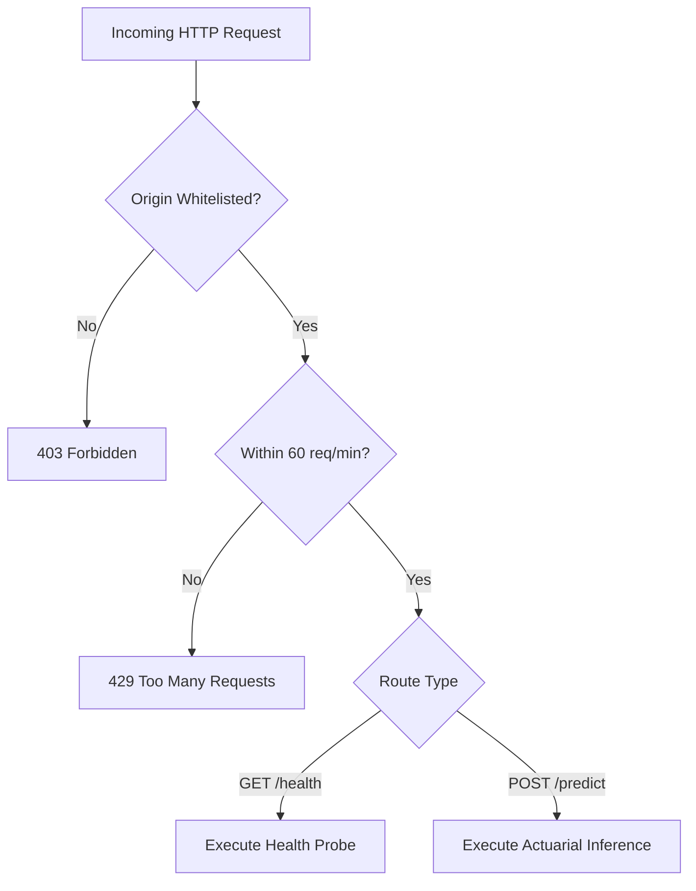
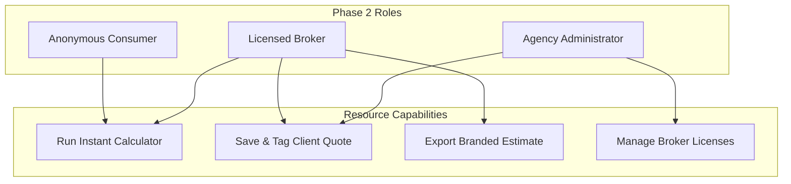

# Authorization Flow: DeltaCare

**Document Version**: 1.0.0  
**Phase**: Pre-Development Foundation Phase  
**Author**: Senior Security Architect  
**Status**: Authoritative Architectural Baseline  
**Approved References**: [ADR-004](../decisions/004-stateless-b2c-mvp.md)

---

## 1. Phase 1 Authorization Model: Public Resource Access

In Phase 1 (MVP), access to endpoints is regulated by **Network & Rate Boundaries** rather than individual user permissions:

### 1.1 Authorization Matrix (Phase 1)

| Route | Actor | Permission Condition | Action on Failure |
| :--- | :--- | :--- | :--- |
| `GET /health` | Any Client / Probe | None (Unrestricted) | 200 OK |
| `POST /predict` | Anonymous Web Client | Valid CORS Origin + Rate Limit $< 60/\text{min}$ | HTTP 403 (CORS) or HTTP 429 (Rate) |
| `/admin/*` | All Actors | **Route Does Not Exist** | HTTP 404 Not Found |

---

## 2. Phase 2 Authorization Model: Role-Based Access Control (RBAC)

In Phase 2, the system will enforce structured Role-Based Access Control:

### 2.1 Role Capabilities Matrix (Phase 2 Conceptual)

| Resource / Endpoint | Anonymous Consumer | Licensed Broker | Agency Administrator |
| :--- | :---: | :---: | :---: |
| `POST /predict` (Stateless) | **ALLOW** | **ALLOW** | **ALLOW** |
| `POST /quotes` (Persistent) | DENY (401) | **ALLOW** | **ALLOW** |
| `GET /quotes/:id` | DENY (401) | **ALLOW (Own Quotes)** | **ALLOW (Agency Quotes)** |
| `GET /broker/export-pdf` | DENY (401) | **ALLOW** | **ALLOW** |
| `POST /admin/users` | DENY (403) | DENY (403) | **ALLOW** |

