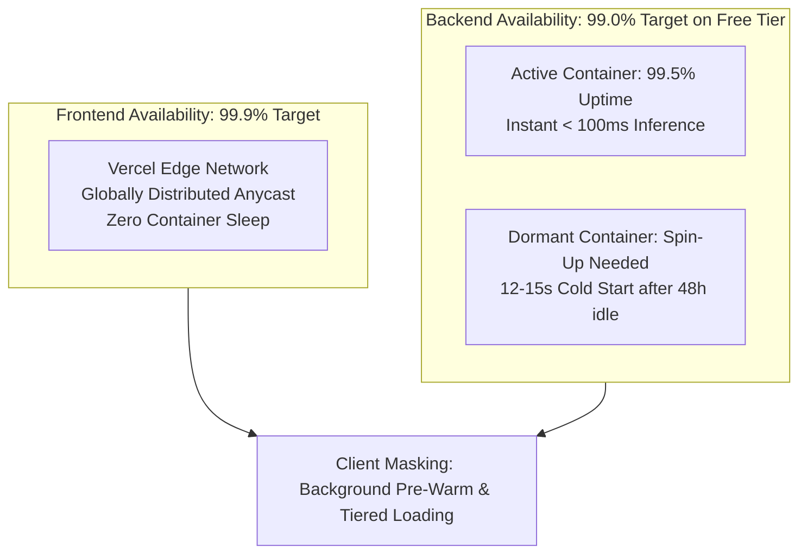

# Availability Strategy: DeltaCare

**Document Version**: 1.0.0  
**Phase**: Pre-Development Foundation Phase  
**Author**: Principal Software Architect & DevOps Lead  
**Status**: Authoritative Architectural Baseline  
**Approved References**: [ADR-002](../decisions/002-zero-dollar-hosting-strategy.md)

---

## 1. Availability Model & Targets

DeltaCare establishes distinct availability objectives for its frontend presentation layer and its backend machine learning inference engine.

---

## 2. High-Availability Dimensions

### 2.1 Frontend Web Layer (Target: 99.9% SLA)
- Hosted on Vercel's multi-region edge content delivery network.
- Static assets and JavaScript bundles are cached globally.
- Immune to server crashes or regional cloud provider data center outages.

### 2.2 Backend Inference Layer (Target: 99.0% Availability on Free Tier)
- **Active State Availability**: When active, the container delivers $> 99.5\%$ uptime.
- **Dormancy State (The Cold-Start Reality)**: Free Hugging Face Spaces enter sleep mode after ~48 hours of zero incoming traffic.
- **Availability Mitigation (Optimistic Pre-Warming)**:
  - The Next.js frontend issues an automated, non-blocking `GET /health` request upon initial DOM mounting.
  - While the consumer spends 10–20 seconds reading the form, selecting their gender, and adjusting their age, the backend container completes its boot sequence in the background.
  - By the time the user clicks **"Get Instant Quote"**, the container is warm, delivering sub-second calculation.

---

## 3. Availability Degradation Matrix

| Platform Scenario | System State | User Experience | Recovery Action |
| :--- | :--- | :--- | :--- |
| **Normal Traffic** | Backend Warm | Instant calculation ($< 100\text{ms}$). | Immediate results rendered. |
| **Dormant Server** | Backend Cold Booting | User sees smooth staged loading states (0–2s spinner $\rightarrow$ 3–10s skeleton wake-up message). | Resolves automatically within 15 seconds. |
| **Backend Total Outage**| HF Space Unreachable | Form remains fully interactive; quote submission trips 20s timeout guardrail. | Displays friendly retry card: *"Our servers are warming up. Please click calculate again."* |

