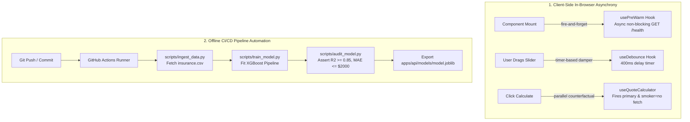

# Background Jobs & Asynchronous Workflows: DeltaCare

**Document Version**: 1.0.0  
**Phase**: Pre-Development Foundation Phase  
**Author**: Principal Software Architect & DevOps Engineer  
**Status**: Authoritative Architectural Baseline  
**Approved References**: [ADR-002](../decisions/002-zero-dollar-hosting-strategy.md), [ADR-003](../decisions/003-unified-sklearn-pipeline.md)

---

## 1. Phase 1 Architecture: In-Process Asynchrony & Build Jobs

In Phase 1 (MVP), **DeltaCare has NO PERSISTENT WORKER CLUSTER** (no Celery, Redis Queue, or RabbitMQ).

All background and asynchronous operations fall into two categories:
1. **Client-Side Non-Blocking Workflows** (In-Browser Web Worker / Async Promises).
2. **Offline CI/CD Batch Pipelines** (Headless Data Ingestion & Model Training).

---

## 2. Granular Workflow Specifications

### 2.1 The What-If Counterfactual Parallel Dispatch
When a user with `smoker: yes` requests a quote, the client-side hook executes two parallel promises:
- `fetchPrimaryQuote(inputs)` $\rightarrow$ Calculates quote with `smoker: yes`.
- `fetchCounterfactualQuote({ ...inputs, smoker: 'no' })` $\rightarrow$ Calculates hypothetical non-smoker quote.
- Both promises resolve via `Promise.allSettled()`.
- The client subtracts the non-smoker total from the smoker total to compute the exact annual and monthly savings delta.

### 2.2 Phase 2 Background Workflows (Deferred)
When Phase 2 introduces agency-branded PDF exports and batch lead underwriting:
- **Architecture**: A lightweight asynchronous task queue (e.g., Python `rq` with Redis or Celery).
- **Tasks**:
  - `generate_broker_quote_pdf(quote_id, broker_id)` $\rightarrow$ Headless HTML-to-PDF compilation.
  - `batch_underwrite_client_roster(csv_upload_id)` $\rightarrow$ Multi-record inference processing.

