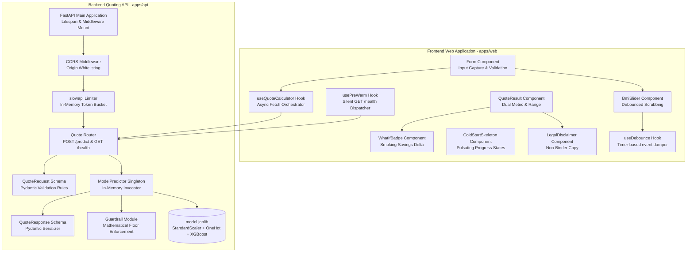

# Component Architecture: DeltaCare

**Document Version**: 1.0.0  
**Phase**: Pre-Development Foundation Phase  
**Author**: Principal Software Architect  
**Status**: Authoritative Architectural Baseline  
**Approved References**: [ADR-001](../decisions/001-decoupled-monorepo.md), [ADR-003](../decisions/003-unified-sklearn-pipeline.md)

---

## 1. System Component Decomposition

DeltaCare is decomposed into isolated, single-responsibility components with strict cohesion and zero circular dependencies.

---

## 2. Component Responsibility Matrix

| Component | Layer | Input | Output | Single Responsibility |
| :--- | :--- | :--- | :--- | :--- |
| `BmiSlider` | Frontend UI | Raw mouse/touch events | Debounced numeric BMI | Smooth slider scrubbing without network thrashing. |
| `useQuoteCalculator` | Frontend Hook | Form field state | Primary & What-If quote states | Orchestrates parallel/counterfactual fetches and computes deltas. |
| `usePreWarm` | Frontend Hook | Page mount event | Silent health status | Awakens dormant Hugging Face Space without user interruption. |
| `slowapi Limiter` | Backend Core | Client IP address | Token bucket balance / 429 | Guards container from brute-force scraping and DDoS. |
| `QuoteRequest` | Backend Schema | Incoming JSON dictionary | Typed Python object | Enforces actuarial input bounds ($18 \le \text{age} \le 100$, enums). |
| `ModelPredictor` | Backend ML | Single-row Pandas DataFrame | Raw continuous prediction | In-memory evaluation through unified pipeline artifact. |
| `GuardrailModule` | Backend ML | Raw float prediction | Clamped float ($\ge \$1,000$) | Guarantees business validity of financial estimates. |

