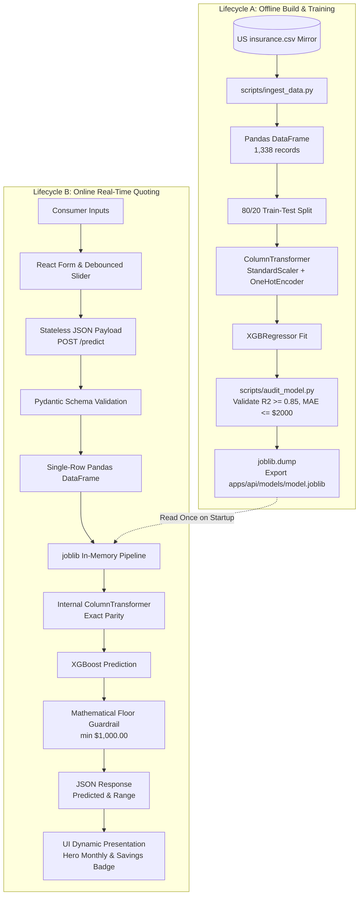

# Data Flow Architecture: DeltaCare

**Document Version**: 1.0.0  
**Phase**: Pre-Development Foundation Phase  
**Author**: Principal Software Architect  
**Status**: Authoritative Architectural Baseline  
**Approved References**: [ADR-003](../decisions/003-unified-sklearn-pipeline.md), [ADR-004](../decisions/004-stateless-b2c-mvp.md)

---

## 1. End-to-End Data Flow Pipeline

The flow of data through DeltaCare spans two distinct lifecycles:
1. **The Offline Training Lifecycle (Data Ingestion $\rightarrow$ Pipeline Serialization)**
2. **The Online Inference Lifecycle (Browser Input $\rightarrow$ In-Memory Prediction $\rightarrow$ UI Presentation)**

---

## 2. Transformation Mechanics & Zero-Skew Guarantee

### 2.1 Numerical Features (`age`, `bmi`, `children`)
- **Offline Training**: `StandardScaler` computes mean ($\mu$) and standard deviation ($\sigma$) across training splits.
- **Online Serving**: The exact fitted $(\mu, \sigma)$ vectors stored inside `model.joblib` transform incoming single-row inputs. Zero manual normalization equations exist in the API layer.

### 2.2 Categorical Features (`sex`, `smoker`, `region`)
- **Offline Training**: `OneHotEncoder(handle_unknown='ignore')` maps discrete strings to binary feature columns.
- **Online Serving**: The identical dictionary mapping processes incoming strings (`"yes"`, `"female"`, `"southwest"`), eliminating manual string parsing or mapping dictionaries in the API routes.

