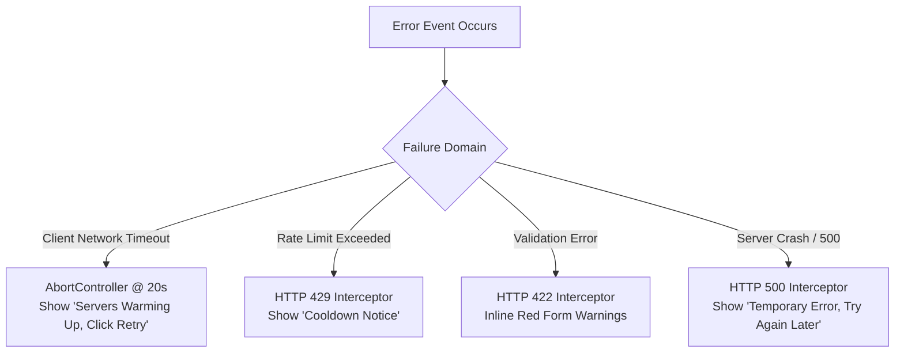

# Error Handling & Fault Resilience: DeltaCare

**Document Version**: 1.0.0  
**Phase**: Pre-Development Foundation Phase  
**Author**: Principal Software Architect & QA Engineer  
**Status**: Authoritative Architectural Baseline  
**Approved References**: [ADR-002](../decisions/002-zero-dollar-hosting-strategy.md), [ADR-004](../decisions/004-stateless-b2c-mvp.md)

---

## 1. Unified Error Handling Taxonomy

DeltaCare implements a structured error taxonomy where every potential failure is intercepted, classified, and rendered gracefully to the user without leaking stack traces or internal secrets.



---

## 2. Granular Failure Modes & Responses

| Error Code / Event | Failure Root Cause | Backend Action | Frontend User Presentation |
| :--- | :--- | :--- | :--- |
| **HTTP 422** | User enters out-of-bounds input (e.g., `age: 12`, `bmi: 85.0`). | FastAPI returns Pydantic field-level error dictionary. | Highlights invalid field in red with helpful hint (e.g., *"Age must be between 18 and 100"*). |
| **HTTP 429** | Rapid slider scrubbing or bot script breaches 60 req/min limit. | `slowapi` rejects with `HTTP 429` & `Retry-After: 60`. | Non-destructive warning: *"Calculation limit reached. Please wait a moment before recalculating."* |
| **HTTP 403** | Request originates from unauthorized domain / curl without header. | CORS middleware terminates connection. | Generic browser network rejection. |
| **Timeout (20s)** | Dormant Hugging Face Space takes $> 20\text{s}$ to boot or hangs. | Container runtime spinning up. | Actionable recovery card: *"Our servers are warming up. Please click calculate again."* with Retry button. |
| **HTTP 500** | Unexpected runtime exception or model deserialization failure. | Structured logger captures stack trace; returns sanitized error JSON. | Friendly notice: *"We encountered a temporary calculation issue. Please try again shortly."* |

---

## 3. Standardized Error Response Payload

For any application-level error (4xx/5xx), the backend API returns a structured JSON contract:

```json
{
  "error": {
    "code": "RATE_LIMIT_EXCEEDED",
    "message": "Too many requests. Limit is 60 requests per minute.",
    "details": null,
    "timestamp": "2026-11-08T02:00:00Z"
  }
}
```

