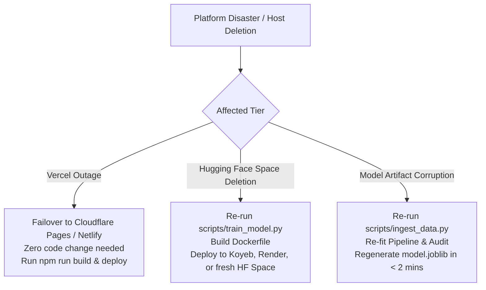

# Failure Recovery & Disaster Resilience: DeltaCare

**Document Version**: 1.0.0  
**Phase**: Pre-Development Foundation Phase  
**Author**: Principal Software Architect & DevOps Lead  
**Status**: Authoritative Architectural Baseline  
**Approved References**: [ADR-001](../decisions/001-decoupled-monorepo.md), [ADR-002](../decisions/002-zero-dollar-hosting-strategy.md), [ADR-003](../decisions/003-unified-sklearn-pipeline.md)

---

## 1. Disaster Recovery & Fault Resilience Framework

Because DeltaCare operates statelessly in Phase 1 without a persistent database, Disaster Recovery (DR) is focused on **Code Portability, Headless Artifact Reconstruction, and Platform Failover**.

---

## 2. Recovery Time Objective (RTO) & Recovery Point Objective (RPO)

| Subsystem | RTO (Max Downtime) | RPO (Max Data Loss) | Recovery Mechanism |
| :--- | :--- | :--- | :--- |
| **Frontend Client (`apps/web`)** | $< 15\text{ minutes}$ | **0 seconds** (Code in Git) | Redeploy static bundle to Vercel or backup host (Cloudflare Pages). |
| **Backend API (`apps/api`)** | $< 20\text{ minutes}$ | **0 seconds** (Stateless) | Launch fresh Docker container on Hugging Face Spaces or alternative container platform. |
| **Machine Learning Model** | $< 5\text{ minutes}$ | **0 seconds** (Deterministic) | Headless execution of `scripts/train_model.py` rebuilds `model.joblib`. |
| **Consumer Calculation Data** | **N/A** | **N/A** | **Zero Data Retention** (Stateless transactional model). |

---

## 3. Disaster Recovery Playbooks

### Playbook 1: Total Loss of Hugging Face Space
1. Clone the repository from GitHub: `git clone https://github.com/your-username/DeltaCare.git`.
2. Verify local Python environment and dependencies: `pip install -r apps/api/requirements.txt`.
3. Re-train and verify the model artifact: `python scripts/train_model.py && python scripts/audit_model.py`.
4. Initialize a new Hugging Face Space using the Docker SDK.
5. Push the repository tree: `git push huggingface main`.
6. Update `NEXT_PUBLIC_API_URL` in Vercel environment variables.

### Playbook 2: Vercel Service Disruption
1. Connect the `DeltaCare` repository to Cloudflare Pages or Netlify.
2. Set root directory to `apps/web`.
3. Set build command to `npm run build` and output directory to `out` (or `.next`).
4. Set environment variable `NEXT_PUBLIC_API_URL` to point to the active Hugging Face Space URL.
5. Deploy. Total downtime: $< 10\text{ minutes}$.

