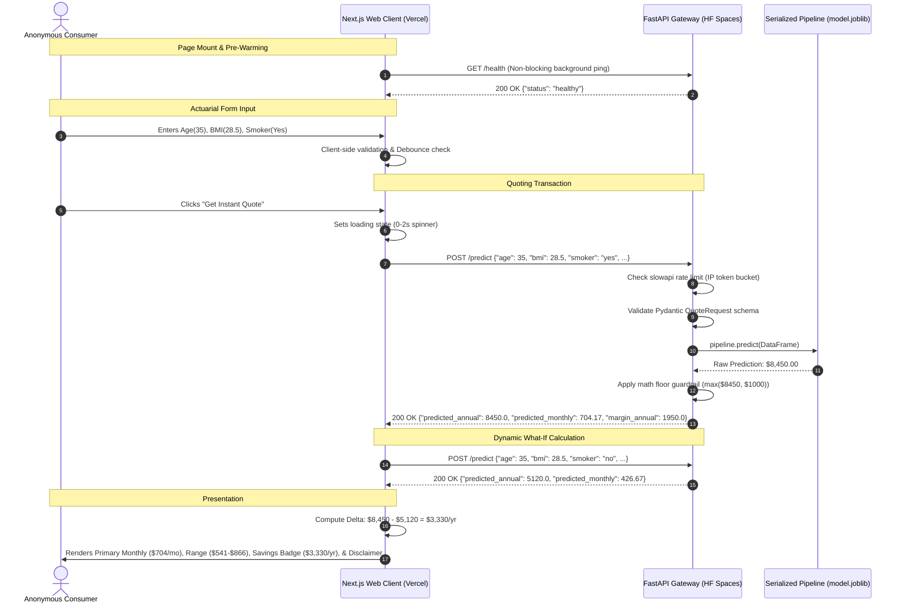

# High-Level Design (HLD): DeltaCare

**Document Version**: 1.0.0  
**Phase**: Pre-Development Foundation Phase  
**Author**: Principal Software Architect  
**Status**: Authoritative Architectural Baseline  
**Approved References**: [ADR-001](../decisions/001-decoupled-monorepo.md), [ADR-002](../decisions/002-zero-dollar-hosting-strategy.md), [ADR-004](../decisions/004-stateless-b2c-mvp.md)

---

## 1. High-Level System Workflow

The end-to-end execution flow of DeltaCare links browser event handling with low-latency containerized inference.

---

## 2. Component Design & Responsibilities

### 2.1 Web Presentation Component (`apps/web`)
- **Single-Page Form**: Captures 6 actuarial inputs with immediate browser-side validation.
- **Interactive Slider Component**: Provides a synchronized BMI slider and numeric input field wrapped in a 400ms debounce handler.
- **Dynamic Result Card**:
  - Emphasizes Monthly Premium as the dominant hero metric.
  - Computes and renders statistical confidence brackets ($\pm \text{MAE}$).
  - Computes counterfactual lifestyle deltas (Smoking Cessation savings badge).
- **Cold-Start Orchestrator**: Manages progressive UI feedback during dormant container wake-ups.

### 2.2 Quoting Engine API Component (`apps/api`)
- **Application Gateway**: Configured via FastAPI and served by Uvicorn.
- **Security & Throttling Subsystem**: Enforces CORS origin restrictions and in-memory rate limiting.
- **Schema Validation Gateway**: Guarantees typed contracts via Pydantic; rejects malformed inputs with HTTP 422.
- **In-Memory ML Singleton**: Pre-loads the serialized XGBoost pipeline on server startup to guarantee sub-100ms inference times.
- **Business Guardrail Filter**: Enforces mathematical floors to eliminate negative or absurd predictions.

---

## 3. Communication Protocols & Standards

| Communication Path | Protocol | Payload Format | Security Transport | Latency Target |
| :--- | :--- | :--- | :--- | :--- |
| **Browser $\rightarrow$ Vercel CDN** | HTTPS / HTTP/2 | HTML / JS / CSS bundle | TLS 1.3 | $< 200\text{ms}$ |
| **Browser $\rightarrow$ API Gateway** | HTTPS / REST | JSON (`QuoteRequest`) | TLS 1.3 + CORS | $< 100\text{ms}$ (active) |
| **Gateway $\rightarrow$ ML Singleton** | In-Process Memory | Pandas DataFrame | Process boundary | $< 5\text{ms}$ |

