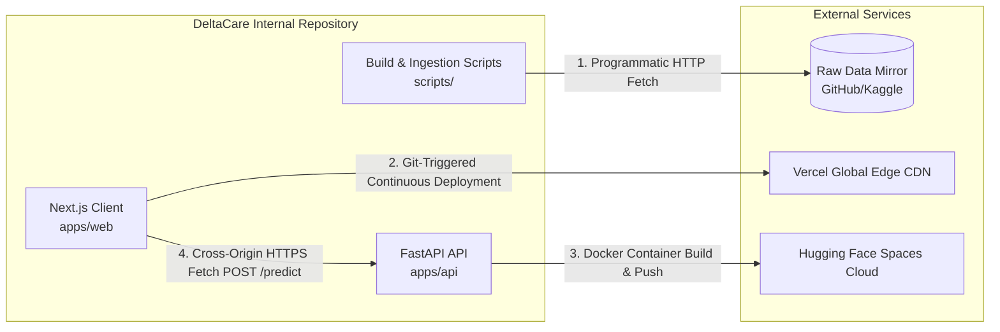

# Integration Architecture: DeltaCare

**Document Version**: 1.0.0  
**Phase**: Pre-Development Foundation Phase  
**Author**: Principal Software Architect  
**Status**: Authoritative Architectural Baseline  
**Approved References**: [ADR-001](../decisions/001-decoupled-monorepo.md), [ADR-002](../decisions/002-zero-dollar-hosting-strategy.md)

---

## 1. System Integration Topography

DeltaCare intentionally minimizes external third-party integrations to preserve operational independence and honor the strict **$0 perpetual budget** requirement.

---

## 2. Integration Protocols & Data Boundaries

| Integration Point | Source System | Target System | Protocol / Payload | Direction | Authentication / Security |
| :--- | :--- | :--- | :--- | :--- | :--- |
| **Data Ingestion** | `scripts/ingest_data.py` | GitHub Raw Mirror | HTTPS GET / Plain CSV | Inbound | Public Read-Only / None |
| **Client Quoting** | `apps/web` (Browser) | `apps/api` (FastAPI) | HTTPS POST / JSON | Bidirectional | CORS Domain Whitelist + slowapi |
| **Server Pre-Warm** | `apps/web` (Browser) | `apps/api` (FastAPI) | HTTPS GET / Plain JSON | Bidirectional | CORS Domain Whitelist |
| **Web Deployment** | GitHub Repo | Vercel Platform | Git Webhook / Build Hook | Outbound | SSH / GitHub App Integration |
| **API Deployment** | GitHub Repo | Hugging Face Spaces | Git LFS Push / Docker Sync | Outbound | Personal Access Token / Git SSH |

---

## 3. Dependency Management & Boundary Isolation

- **Third-Party API Independence**: DeltaCare runtime has **zero external runtime API dependencies**. It does not call OpenAI, Stripe, Google Maps, or external underwriting engines during user sessions. If external networks experience outages, DeltaCare's quoting engine remains 100% operational.
- **Fail-Safe Decoupling**: If the backend Hugging Face Space is temporarily unreachable, the frontend continues to render the full actuarial form and provides actionable user feedback (cold-start skeleton $\rightarrow$ retry button) rather than crashing the browser.

