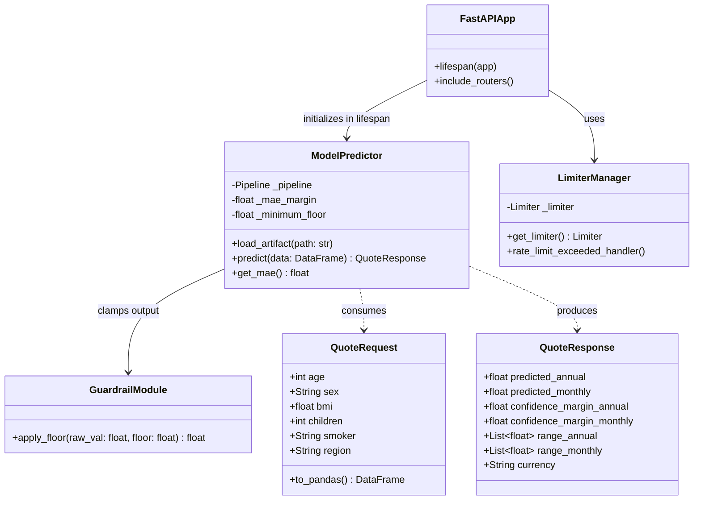
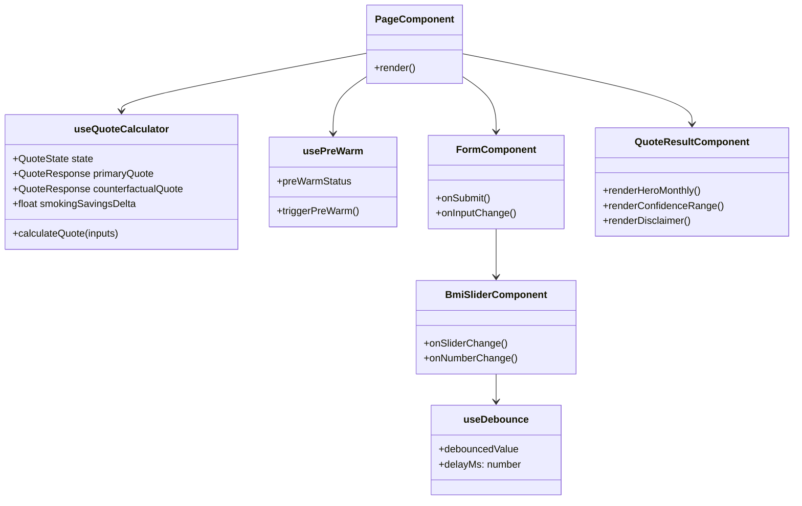

# Low-Level Design (LLD): DeltaCare

**Document Version**: 1.0.0  
**Phase**: Pre-Development Foundation Phase  
**Author**: Principal Software Architect  
**Status**: Authoritative Architectural Baseline  
**Approved References**: [ADR-003](../decisions/003-unified-sklearn-pipeline.md), [ADR-004](../decisions/004-stateless-b2c-mvp.md)

---

## 1. Class & Module Architecture (Backend API)



---

## 2. Granular Component Design

### 2.1 Backend Lifespan & Singleton Initialization
To avoid multi-second deserialization latency on every incoming HTTP request, the ML model is loaded exactly once into RAM during the FastAPI lifespan startup event:

```python
# Conceptual LLD lifespan pattern
from contextlib import asynccontextmanager
from fastapi import FastAPI
from src.ml.predictor import ModelPredictor

@asynccontextmanager
async def lifespan(app: FastAPI):
    # Startup: Load model.joblib once into process memory
    ModelPredictor.load_artifact("models/model.joblib")
    yield
    # Shutdown: Clean memory
```

### 2.2 Mathematical Guardrail Specification
The guardrail function guarantees that extreme outlier inputs or non-linear edge splits do not produce invalid financial values:

```python
# apps/api/src/ml/guardrails.py logic
MINIMUM_ANNUAL_FLOOR = 1000.00  # $83.33/month

def apply_prediction_guardrail(raw_prediction: float) -> float:
    """Clamps raw regression output to a business-valid non-negative floor."""
    if raw_prediction < MINIMUM_ANNUAL_FLOOR:
        return MINIMUM_ANNUAL_FLOOR
    return round(raw_prediction, 2)
```

---

## 3. Frontend Component & Hook Architecture (`apps/web`)



### 3.1 Debounce Hook Mechanics
- When a user scrubs the BMI slider, input events fire rapidly (every ~15ms).
- `useDebounce` intercepts the value and holds a timeout window of `400ms`.
- Only when the user pauses scrubbing for $\ge 400\text{ms}$ is the state updated, dispatching a single network fetch.
- This ensures fluid visual interaction while completely protecting the API rate limit (max 60 req/min).

