# Module Boundaries & Interface Contracts: DeltaCare

**Document Version**: 1.0.0  
**Phase**: Pre-Development Foundation Phase  
**Author**: Principal Software Architect  
**Status**: Authoritative Architectural Baseline  
**Approved References**: [ADR-001](../decisions/001-decoupled-monorepo.md), [ADR-003](../decisions/003-unified-sklearn-pipeline.md)

---

## 1. Domain Module Boundaries

To prevent tight coupling and preserve clean service boundaries, DeltaCare enforces explicit isolation between its three primary subsystems:

```mermaid
graph LR
    subgraph Boundary_Web [Boundary 1: Web Client - TypeScript / Next.js]
        WebComponents[UI Presentation Components]
        WebHooks[State & Orchestration Hooks]
        WebTypes[TypeScript Contract Interfaces]
    end

    subgraph Boundary_REST [Boundary 2: Public Interface - OpenAPI / HTTP]
        HealthCheck[GET /health]
        PredictQuote[POST /predict]
    end

    subgraph Boundary_API [Boundary 3: Backend API - Python / FastAPI]
        APISchemas[Pydantic Request & Response Schemas]
        APISecurity[CORS & slowapi Middleware]
        APIPredictor[Model Predictor Singleton]
    end

    subgraph Boundary_ML [Boundary 4: Machine Learning - Scikit-Learn]
        MLPipeline[Unified Pipeline Artifact model.joblib]
        MLTraining[Offline Training Script train.py]
    end

    Boundary_Web -->|HTTP / JSON Payloads| Boundary_REST
    Boundary_REST --> Boundary_API
    Boundary_API -->|In-Process Python Call| Boundary_ML
```



---

## 2. Inviolable Cross-Boundary Rules

1. **Frontend $\leftrightarrow$ Backend Isolation**:
   - The frontend never accesses local backend files, training datasets, or environment secrets.
   - All communication is conducted over network boundaries via standard JSON over HTTPS.
2. **Backend Gateway $\leftrightarrow$ ML Pipeline Isolation**:
   - The API routing layer (`src/main.py`) must never perform feature scaling, arithmetic normalization, or string encoding.
   - The routing layer converts the Pydantic schema to a raw DataFrame and hands it to `ModelPredictor`.
   - The ML pipeline handles all transformations internally.
3. **Training Environment $\leftrightarrow$ Serving Runtime Isolation**:
   - Training scripts (`scripts/train_model.py`) run independently to produce `model.joblib`.
   - The production API server loads the serialized artifact as read-only. It never retrains or writes to `model.joblib` during runtime.

---

## 3. Interface Contracts (Data Dictionaries)

### 3.1 Input Interface: `QuoteRequest`
```json
{
  "age": 35,
  "sex": "male",
  "bmi": 28.5,
  "children": 2,
  "smoker": "no",
  "region": "northwest"
}
```

### 3.2 Output Interface: `QuoteResponse`
```json
{
  "predicted_annual": 4350.00,
  "predicted_monthly": 362.50,
  "confidence_margin_annual": 1950.00,
  "confidence_margin_monthly": 162.50,
  "range_annual": [2400.00, 6300.00],
  "range_monthly": [200.00, 525.00],
  "currency": "USD"
}
```

