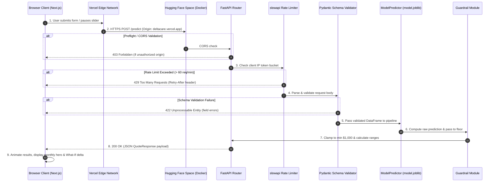

# Request Lifecycle: DeltaCare

**Document Version**: 1.0.0  
**Phase**: Pre-Development Foundation Phase  
**Author**: Principal Software Architect  
**Status**: Authoritative Architectural Baseline  
**Approved References**: [ADR-002](../decisions/002-zero-dollar-hosting-strategy.md), [ADR-004](../decisions/004-stateless-b2c-mvp.md)

---

## 1. Complete HTTP Request Lifecycle (`POST /predict`)

This document traces the path of an individual prediction request from DOM dispatch to browser rendering, detailing all validation, security, and processing gates.

---

## 2. Granular Step-by-Step Breakdown

1. **Client Dispatch**: User triggers submit or pauses slider. `useQuoteCalculator` initiates an asynchronous fetch with an `AbortController` set to 20 seconds.
2. **Transport & Routing**: Request travels over TLS 1.3 to Hugging Face Spaces port `7860`.
3. **CORS Evaluation**: FastAPI `CORSMiddleware` inspects the `Origin` header. If origin does not match the whitelist, request terminates immediately.
4. **Rate Limit Audit**: `slowapi` checks the in-memory token bucket for the client IP. If tokens are exhausted ($> 60\text{ req/min}$), returns HTTP 429.
5. **Schema Validation**: Pydantic casts the payload into `QuoteRequest`. If data types or bounds violate rules ($18 \le \text{age} \le 100$), returns HTTP 422 with a structured error dictionary.
6. **Inference Pipeline**: The singleton `ModelPredictor` converts the validated object to a single-row Pandas DataFrame and executes `pipeline.predict(df)`.
7. **Business Guardrail**: Output passes through `apply_prediction_guardrail()`, clamping any value $< \$1,000.00$.
8. **Response Packaging**: `QuoteResponse` computes monthly values (`annual / 12`) and confidence bounds (`annual` $\pm \text{MAE}$) and serializes to JSON.
9. **Client Rendering**: Browser parses response, updates React state, transitions away from loading skeleton, and displays the quote card.

