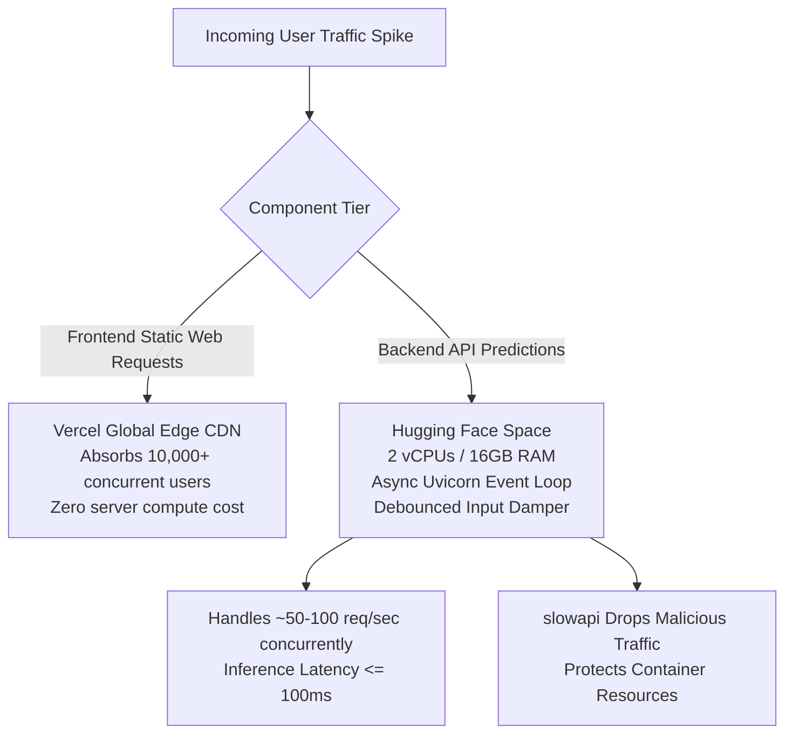

# Scalability Strategy: DeltaCare

**Document Version**: 1.0.0  
**Phase**: Pre-Development Foundation Phase  
**Author**: Principal Software Architect  
**Status**: Authoritative Architectural Baseline  
**Approved References**: [ADR-002](../decisions/002-zero-dollar-hosting-strategy.md), [ADR-004](../decisions/004-stateless-b2c-mvp.md)

---

## 1. Scalability Dimensions & Strategies

DeltaCare is engineered to scale across two distinct dimensions while strictly honoring the **$0 perpetual hosting constraint**:
1. **Frontend Traffic Scaling (Infinite Horizontal Edge Scale)**
2. **Backend Compute Scaling (Vertical Efficiency & Concurrency Optimization)**

---

## 2. Granular Tier Scalability

### 2.1 Frontend Scaling (Edge CDN)
- Because `apps/web` compiles to a static single-page application with edge-served assets, Vercel automatically distributes files across hundreds of global Anycast points of presence.
- **Capacity**: Can handle tens of thousands of simultaneous visitors with zero increase in cloud hosting costs.
- **Zero Cold Starts**: The frontend never sleeps and delivers instantaneous First Contentful Paint (FCP).

### 2.2 Backend Scaling (In-Memory Micro-Efficiency)
- **Memory Overhead Margin**: The FastAPI application and serialized XGBoost model consume $\approx 500\text{MB}$ of RAM. Deployed on Hugging Face Spaces' 16GB tier, the application operates with a **$32\times$ memory headroom**, completely immune to memory pressure spikes.
- **Inference Concurrency**: Because the fitted pipeline executes read-only matrix multiplications on single-row inputs, inference takes $< 15\text{ms}$ of pure CPU time. A single container easily processes 50–100 requests per second.
- **Client-Side Throttling (Debounce)**: Debouncing the BMI slider at 400ms reduces backend request volume during active user interaction by **$85–90\%$**, effectively dampening traffic at the source.

---

## 3. Bottleneck Analysis & Threshold Triggers

| Scalability Bottleneck | Capacity Threshold | Trigger Indicator | Scaling Remediation Strategy |
| :--- | :--- | :--- | :--- |
| **API CPU Saturation** | $> 120\text{ req/sec}$ continuous | CPU utilization $> 85\%$ | Horizontal container replication or upgrading to dedicated multi-core tier (Phase 2). |
| **Abuse Traffic** | Excessive bot scraping | Elevated HTTP 429 rate | Tighten `slowapi` window or deploy Cloudflare Turnstile CAPTCHA. |
| **Container Memory** | $> 2.0\text{GB}$ | Memory leak alert | Inspect Pandas memory management; force explicit garbage collection. |

