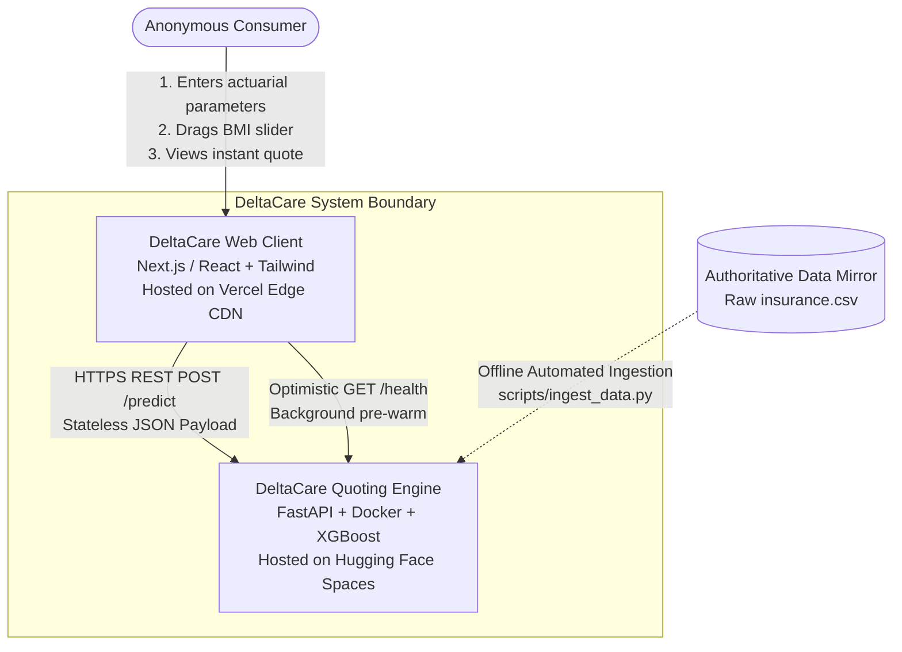
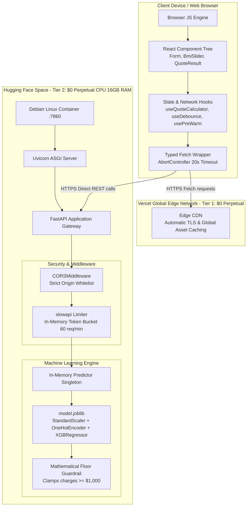

# System Architecture: DeltaCare

**Document Version**: 1.0.0  
**Phase**: Pre-Development Foundation Phase  
**Author**: Principal Software Architect  
**Status**: Authoritative Architectural Baseline  
**Approved References**: [ADR-001](../decisions/001-decoupled-monorepo.md), [ADR-002](../decisions/002-zero-dollar-hosting-strategy.md), [ADR-003](../decisions/003-unified-sklearn-pipeline.md), [ADR-004](../decisions/004-stateless-b2c-mvp.md)

---

## 1. Executive Architectural Summary

DeltaCare is architected as a **Decoupled, Two-Tier Cloud Micro-Product** designed to deliver instant, statistically backed health insurance premium estimates with zero persistent state, zero user identity harvesting, and zero infrastructure operating costs.

The architecture strictly separates user presentation and interaction orchestration from actuarial inference execution. All components are designed around a **Stateless Transactional Model** that minimizes operational overhead and ensures maximum resilience on cloud free tiers.

---

## 2. System Context (C4 Level 1)

### Explanation of Context
- **Anonymous Consumer**: The primary user accessing the web interface without authentication or identity disclosure.
- **DeltaCare Web Client**: Static edge-rendered React single-page application executing in the user's browser, responsible for input validation, debounced event firing, and What-If delta presentation.
- **DeltaCare Quoting Engine**: A containerized FastAPI service hosting the in-memory serialized ML pipeline (`model.joblib`), enforcing rate limits, validating incoming schemas, and calculating predictions with mathematical floor guardrails.
- **Authoritative Data Mirror**: Raw public CSV mirror used exclusively during offline build/training cycles to generate the model artifact.

---

## 3. Container Topology (C4 Level 2)

### Container Responsibilities & Operational Bounds

| Container / Layer | Technology | Hosting Tier | Hardware Allocation | Key Responsibility |
| :--- | :--- | :--- | :--- | :--- |
| **Edge Web Client** | Next.js / React, Tailwind CSS | Vercel Hobby Tier | Edge Serverless / CDN | Immediate DOM rendering, form validation, cold-start timer states, What-If diffs. |
| **API Gateway** | FastAPI, Uvicorn, slowapi | Hugging Face Spaces | 2 vCPUs, 16GB RAM | Request throttling (60 req/min), CORS enforcement, Pydantic schema validation. |
| **ML Inference Engine** | Scikit-learn, XGBoost, joblib | In-Memory Singleton | Embedded in FastAPI process | Atomic deserialization of unified pipeline; $< 100\text{ms}$ continuous inference. |

---

## 4. Architectural Principles & Invariants

1. **Strict Decoupling**: Frontend and backend communicate exclusively over standard HTTP/JSON REST interfaces. No internal state, shared databases, or process memories are coupled between tiers.
2. **Zero Train-Serve Skew**: Offline data engineering transformations (`ColumnTransformer`) and inference estimators are bound into an indivisible serialized unit (`model.joblib`), ensuring 100% mathematical parity.
3. **Stateless Privacy Preservation**: Phase 1 processes every prediction transaction in volatile memory. No user inputs or derived estimates are committed to permanent disk, database tables, or persistent logs.
4. **Deterministic Cost Envelope**: Total operating expenditure is locked at exactly **$0.00**. Any architecture proposal requiring paid infrastructure is invalid by definition.

