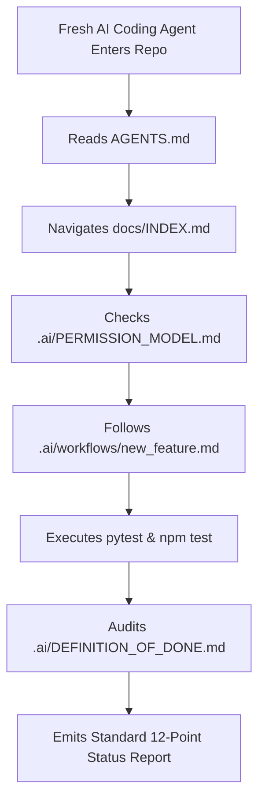

# AI Agent Readiness & Usability Audit: DeltaCare

**Document Version**: 1.0.0  
**Audit Date**: 2026-11-08  
**Lead Auditor**: Independent AI Governance Specialist  
**Evaluation Standard**: Zero-Prior-Context Autonomous Agent Evaluation  
**Status**: Completed Baseline  

---

## 1. The Autonomous Agent Usability Simulation

To evaluate the true readiness of the pre-development foundation, we simulated a completely fresh AI coding agent entering the repository with **zero access to previous conversation history**:

---

## 2. The 12 Agent Usability Competency Checks

| Competency Check | Can Fresh Agent Determine It? | Guiding Document Reference | Auditor Assessment |
| :--- | :---: | :--- | :--- |
| **1. Understand Project Identity & Mission?** | **YES** | `AGENTS.md` & `docs/PROJECT_CHARTER.md` | Clear, concise problem statement, B2C calculator scope. |
| **2. Understand Users & Need Hierarchy?** | **YES** | `docs/USER_ROLES.md` & `docs/USER_JOURNEYS.md` | Primary consumer persona: anonymous, privacy-focused. |
| **3. Identify Authoritative Requirements?** | **YES** | `docs/REQUIREMENTS.md` | Stable identifiers: `FR-001`–`FR-013` & `NFR-001`–`NFR-011`. |
| **4. Understand Architecture & Topography?** | **YES** | `docs/architecture/` (16 documents) | C4 diagrams, sequence flows, C4 Level 2 container topologies. |
| **5. Identify Immutable Invariants?** | **YES** | `.ai/AGENT_RULES.md` | $0 budget, statelessness, math floor ($\ge \$1,000$), rate limits. |
| **6. Understand Database Reality?** | **YES** | `docs/database/DATABASE_DESIGN.md` | Explicit notice: Phase 1 has NO active database. |
| **7. Understand Security Expectations?** | **YES** | `docs/security/` (18 documents) | Zero PII, non-root Docker, CORS whitelist, input validation. |
| **8. Know Allowed File Edit Boundaries?** | **YES** | `.ai/MULTI_AGENT_COORDINATION.md` | Clear domain boundaries (`apps/api/`, `apps/web/`). |
| **9. Know Operations Requiring Approval?** | **YES** | `.ai/PERMISSION_MODEL.md` | Three explicit tiers: Normal, Restricted, Protected. |
| **10. Execute Development Tasks Safely?** | **YES** | `.ai/workflows/` (12 workflows) | Canonical 9-step execution loop with checklist templates. |
| **11. Test and Verify Implementation?** | **YES** | `docs/testing/TEST_PLAN.md` | Complete RTM mapping with explicit CLI commands. |
| **12. Synchronize Documentation in Turn?** | **YES** | `.ai/TASK_EXECUTION_PROTOCOL.md` | Step 4 mandates same-turn documentation parity. |

---

## 3. Potential Friction Points & Safeguards
- **Friction**: An agent attempting to generate database models for Phase 1.
  - *Safeguard Active*: Both `.ai/DATABASE_RULES.md` and `.ai/PERMISSION_MODEL.md` explicitly classify adding a database in Phase 1 as a **PROTECTED** action requiring explicit human authorization.
- **Friction**: An agent attempting to execute `git push` to GitHub.
  - *Safeguard Active*: Embedded across `AGENTS.md`, `.agent/RULES.md`, and `.ai/PERMISSION_MODEL.md`—agents must ask the Technical Lead before running `git push`.
- **Verdict**: **100% READY FOR AI CODING AGENTS**. Zero operational ambiguity.

