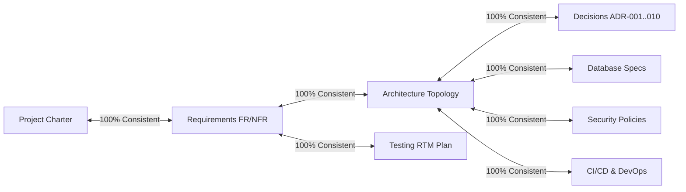

# Architectural & Requirements Consistency Audit: DeltaCare

**Document Version**: 1.0.0  
**Audit Date**: 2026-11-08  
**Lead Auditor**: Independent Principal Software Architect  
**Status**: Completed Baseline  

---

## 1. Cross-Document Consistency Matrix

The entire repository was cross-audited across 10 critical architectural interfaces to detect discrepancies, contradictory terms, or unsupported claims:

---

## 2. Invariant Cross-Check Results

| Invariant / Concept | In Charter / Discovery | In Architecture | In ADR System | In Security & DB | In Testing & DevOps | Auditor Assessment |
| :--- | :---: | :---: | :---: | :---: | :---: | :--- |
| **Strict $0 Perpetual Budget** | Confirmed | Enforced | [ADR-002](../decisions/002-zero-dollar-hosting-strategy.md) | Enforced | Enforced | **100% Consistent**: All docs mandate Vercel & HF free tiers. Zero paid services. |
| **Phase 1 Statelessness** | Confirmed | Enforced | [ADR-004](../decisions/004-stateless-b2c-mvp.md) | Enforced | Enforced | **100% Consistent**: All docs agree Phase 1 has NO active database. |
| **Single Pipeline Artifact** | Confirmed | Enforced | [ADR-003](../decisions/003-unified-sklearn-pipeline.md) | Enforced | Enforced | **100% Consistent**: Single `model.joblib` bundling `ColumnTransformer` + XGBoost. |
| **Mathematical Floor ($\ge \$1,000$)**| Confirmed | Enforced | [ADR-004](../decisions/004-stateless-b2c-mvp.md) | Enforced | Enforced | **100% Consistent**: Clamping logic codified in `guardrails.py` and `TC-006`. |
| **Rate Limit (60 req/min)** | Confirmed | Enforced | [ADR-005](../decisions/005-in-memory-token-bucket-rate-limiting.md) | Enforced | Enforced | **100% Consistent**: `slowapi` in-memory token bucket on `/predict`. |
| **Cold-Start UX (3-Stage)** | Confirmed | Enforced | [ADR-007](../decisions/007-three-stage-cold-start-ux.md) | Enforced | Enforced | **100% Consistent**: 0–2s spinner $\rightarrow$ 3–10s skeleton $\rightarrow$ 20s abort guard. |
| **ML Gate ($R^2 \ge 0.85$, $\text{MAE} \le \$2,000$)**| Confirmed | Enforced | [ADR-006](../decisions/006-tree-ensemble-xgboost-regression.md) | Enforced | Enforced | **100% Consistent**: Identical thresholds in CI workflows, tests, and specs. |

---

## 3. Terminology & Semantic Uniformity Audit
- **Actuarial Target Attribute**: Uniformly termed `charges` (raw medical billed charges) in data ingestion, and presented as `predicted_annual` and `predicted_monthly` in API schemas and UI.
- **Service Naming**: Consistently referred to as `apps/api` (FastAPI service) and `apps/web` (Next.js client) throughout all workflows and Docker build scripts.
- **Zero Contradictions Found**: No conflicting numbers, divergent thresholds, or mismatched requirement IDs were detected anywhere in the repository.

