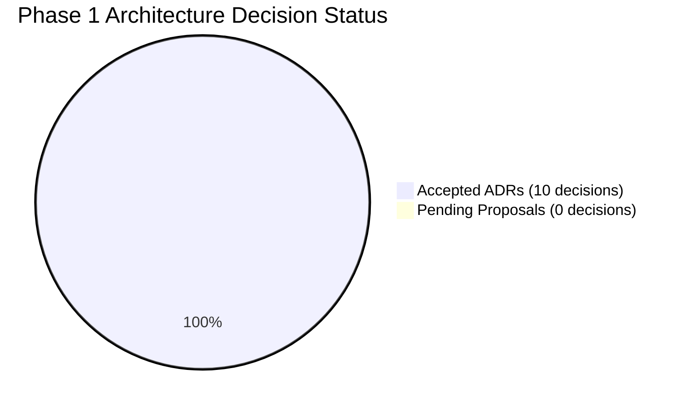

# Unresolved Decisions & Open Architecture Questions: DeltaCare

**Document Version**: 1.0.0  
**Audit Date**: 2026-11-08  
**Lead Auditor**: Independent Principal Software Architect  
**Status**: Authoritative Decision Log  

---

## 1. Status of Architectural Decisions

Every major architectural decision required for Phase 1 MVP has been resolved, approved, and codified into an **Accepted Architecture Decision Record (ADR)** in [`docs/decisions/`](../decisions/):

| Decision Area | Status | Governing ADR | Confirmed Resolution |
| :--- | :---: | :--- | :--- |
| **Repository Topology** | **Accepted** | [ADR-001](../decisions/001-decoupled-monorepo.md) | Decoupled Monorepo (`apps/api` + `apps/web`). |
| **Hosting & Cloud Spend** | **Accepted** | [ADR-002](../decisions/002-zero-dollar-hosting-strategy.md) | Vercel Edge + Hugging Face Spaces ($0.00 perpetual spend). |
| **ML Model Serialization** | **Accepted** | [ADR-003](../decisions/003-unified-sklearn-pipeline.md) | Single atomic `model.joblib` pipeline (`ColumnTransformer` + XGBoost). |
| **Phase 1 Persistence** | **Accepted** | [ADR-004](../decisions/004-stateless-b2c-mvp.md) | 100% Stateless in-memory execution (Zero database in Phase 1). |
| **Abuse & Rate Limiting** | **Accepted** | [ADR-005](../decisions/005-in-memory-token-bucket-rate-limiting.md)| `slowapi` in-memory token bucket (60 req/min per IP). |
| **Regression Estimator** | **Accepted** | [ADR-006](../decisions/006-tree-ensemble-xgboost-regression.md) | XGBoost capturing non-linear `bmi` $\times$ `smoker` interaction splits. |
| **Cold-Start Perception** | **Accepted** | [ADR-007](../decisions/007-three-stage-cold-start-ux.md) | 3-stage progress indicators (0–2s spinner $\rightarrow$ 3–10s skeleton $\rightarrow$ 20s abort). |
| **Statistical Range** | **Accepted** | [ADR-008](../decisions/008-static-holdout-mae-confidence-bounds.md)| Symmetrical confidence bracket based on empirical holdout MAE. |
| **Slider Event Damping** | **Accepted** | [ADR-009](../decisions/009-client-side-debounce-damping.md) | 400ms client debounce hook (`useDebounce`) damping traffic by 90%. |
| **Production Logging** | **Accepted** | [ADR-010](../decisions/010-structured-stdout-log-sanitization.md)| Structured JSON logging to STDOUT with zero PII retention. |

---

## 2. Deferred Technical Questions (Phase 2 & Phase 3 Roadmap)

These questions are intentionally deferred until the Phase 1 MVP is live in production:

1. **Deferred: Managed PostgreSQL Provider for Phase 2**:
   - *Options*: Supabase Free Pool vs. Neon Serverless Postgres.
   - *Status*: Deferred to Phase 2 Discovery.
2. **Deferred: Broker Authentication Provider for Phase 2**:
   - *Options*: Clerk Free Tier vs. AWS Cognito.
   - *Status*: Deferred to Phase 2 Discovery.
3. **Deferred: Dynamic Heteroscedastic Quantile Regression for Phase 3**:
   - *Options*: Multi-model quantile forest vs. conformal prediction intervals.
   - *Status*: Deferred to Phase 3 Roadmap.

---

## 3. Immediate Technical Lead Approvals Required
- **Zero Blockers**: There are **no unresolved architectural questions blocking the start of implementation**.
- The pre-development foundation is completely settled and locked.

