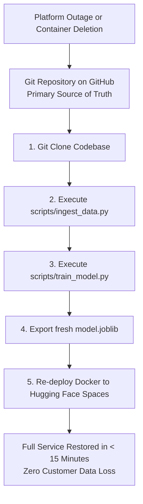

# Backup and Disaster Recovery: DeltaCare

**Document Version**: 1.0.0  
**Phase**: Pre-Development Foundation Phase  
**Author**: Principal Database Architect & DevOps Lead  
**Status**: Authoritative Architectural Baseline  
**Approved References**: [ADR-002](../decisions/002-zero-dollar-hosting-strategy.md), [ADR-004](../decisions/004-stateless-b2c-mvp.md)

---

## 1. Phase 1 Policy: Code-Centric Disaster Recovery

Because DeltaCare Phase 1 is completely stateless, **there are no database backups, database replication streams, or point-in-time recovery (PITR) configurations**.

Disaster recovery in Phase 1 is **100% Code-Centric and Artifact-Deterministic**:

### 1.1 Recovery Metrics (Phase 1)
- **Recovery Point Objective (RPO)**: **0 Seconds** (Zero user data exists to lose).
- **Recovery Time Objective (RTO)**: **$< 15$ Minutes** (Time required to spin up a fresh container on any Docker host).

---

## 2. Phase 2 Database Backup Strategy (Planned PostgreSQL)

When Phase 2 provisions a managed PostgreSQL instance (Supabase / Neon free-tier pool):

1. **Automated Daily Backups**: Managed daily WAL-based backups retained for 7 rolling days.
2. **Pre-Migration Snapshot**: Before applying any Alembic migration in production, an automated full database snapshot is triggered.
3. **Restoration Drills**: Semi-annual automated restore tests verifying that backup dumps can be successfully hydrated into an isolated staging instance.
4. **Encryption**: All database backup dumps are encrypted at rest using AES-256.

