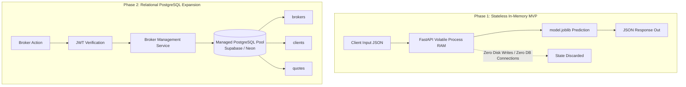

# Database Design & Architecture: DeltaCare

**Document Version**: 1.0.0  
**Phase**: Pre-Development Foundation Phase  
**Author**: Principal Database Architect & Data Integrity Engineer  
**Status**: Authoritative Architectural Baseline  
**Approved References**: [ADR-004](../decisions/004-stateless-b2c-mvp.md)

---

## 1. Executive Data Strategy: Two-Phase Architecture

DeltaCare's data persistence and management strategy is divided into two distinct architectural phases:

1. **Phase 1 (MVP — Active Focus)**: **100% Stateless In-Memory Transactional Model**.
   - No persistent relational database (RDBMS), NoSQL store, or disk cache exists.
   - All transactions are evaluated in volatile memory and returned directly to the client.
   - Eliminates database hosting costs ($0 perpetual budget preserved) and all PII retention liability.
2. **Phase 2 (B2B Expansion — Planned Architectural Extension)**: **Relational PostgreSQL Persistence**.
   - Introduced strictly when licensed insurance brokers require persistent accounts, saved client records, and agency quote histories.
   - Decoupled from the core quoting calculation engine.

---

## 2. Phase 1 Data Ingestion & Tabular Schema Specification

Although Phase 1 operates statelessly online, it relies on an offline training dataset (`insurance.csv`, 1,338 records). The schema of this tabular dataset is strictly governed:

| Column Name | Ingestion Data Type | Validation Bounds | Semantic Meaning |
| :--- | :--- | :--- | :--- |
| `age` | `INTEGER` | $18 \le \text{age} \le 100$ | Age of primary insurance beneficiary in years. |
| `sex` | `VARCHAR(6)` | `male`, `female` | Biological insurance contractor gender. |
| `bmi` | `FLOAT` | $10.0 \le \text{bmi} \le 60.0$ | Body Mass Index ($\text{weight in kg} / (\text{height in meters})^2$). |
| `children` | `INTEGER` | $0 \le \text{children} \le 10$ | Number of dependents covered by the health plan. |
| `smoker` | `VARCHAR(3)` | `yes`, `no` | Tobacco use status (dominant risk factor). |
| `region` | `VARCHAR(9)` | `northeast`, `southeast`, `southwest`, `northwest` | Beneficiary residential region in the US. |
| `charges` | `FLOAT` | $\text{charges} > 0.0$ | Annualized billed medical costs ($y$ target). |

---

## 3. Phase 2 Target Relational Schema Overview

When persistence is enabled in Phase 2, DeltaCare will standardize on **PostgreSQL 15+**:
- **`brokers`**: Registered insurance brokers and agency users.
- **`clients`**: Prospective insurance shoppers managed by brokers.
- **`quotes`**: Historical calculation snapshots tied to client profiles and broker accounts.
- **`agencies`**: Multi-tenant organizations managing broker seats.

