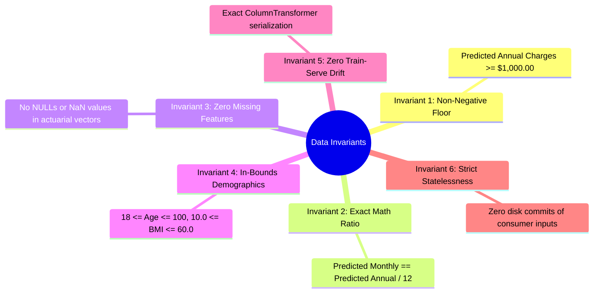

# Data Integrity Rules & Invariants: DeltaCare

**Document Version**: 1.0.0  
**Phase**: Pre-Development Foundation Phase  
**Author**: Principal Database Architect & Quality Assurance Lead  
**Status**: Authoritative Architectural Baseline  
**Approved References**: [ADR-003](../decisions/003-unified-sklearn-pipeline.md), [ADR-004](../decisions/004-stateless-b2c-mvp.md)

---

## 1. The Core Data Invariants

DeltaCare enforces six non-negotiable data integrity invariants across all application layers:

---

## 2. Invariant Specifications & Verification

### Invariant 1: Mathematical Prediction Floor
- **Rule**: No calculated annual premium may fall below **$1,000.00** ($\$83.33/\text{month}$).
- **Enforcement**: Guardrail function `apply_prediction_guardrail()` clamps outputs in `apps/api/src/ml/guardrails.py`.
- **Verification**: Pytest case submitting synthetic negative-leaning feature profiles asserts output equals exactly `$1,000.00`.

### Invariant 2: Monthly-Annual Arithmetic Ratio
- **Rule**: `predicted_monthly` must equal `round(predicted_annual / 12, 2)` within floating-point rounding accuracy.
- **Enforcement**: Computed deterministically in the Pydantic serialization layer of `QuoteResponse`.
- **Verification**: Automated assertion in API test suite.

### Invariant 3: Zero Missing Features
- **Rule**: Every prediction request vector must contain all 6 required fields without `None`, `null`, or `NaN`.
- **Enforcement**: Pydantic schema validation returns HTTP 422 if any field is missing.
- **Verification**: Pytest case verifying rejection of partial JSON payloads.

### Invariant 4: Bounded Demographics
- **Rule**: User inputs must strictly satisfy the empirical bounds of the training dataset:
  - $18 \le \text{age} \le 100$
  - $10.0 \le \text{bmi} \le 60.0$
  - $0 \le \text{children} \le 10$
  - `sex` $\in \{\text{'male'}, \text{'female'}\}$
  - `smoker` $\in \{\text{'yes'}, \text{'no'}\}$
  - `region` $\in \{\text{'northeast'}, \text{'southeast'}, \text{'southwest'}, \text{'northwest'}\}$
- **Enforcement**: Pydantic regex and boundary validators at the API gateway.

### Invariant 5: Zero Train-Serve Preprocessing Drift
- **Rule**: Online inference feature matrices must be generated by the exact same transformers fitted offline.
- **Enforcement**: Deserialization of the unified `model.joblib` pipeline containing `ColumnTransformer`.
- **Verification**: Holdout test set produces identical predictions whether executed via training notebook or FastAPI test client.

### Invariant 6: Strict Statelessness (Zero PII Retention)
- **Rule**: User inputs must never be written to SQLite, PostgreSQL, local files, or un-sanitized logs.
- **Enforcement**: Architectural absence of database drivers and log sanitization in `apps/api/src/core/logger.py`.
- **Verification**: Inspection of disk writes and log outputs during load testing.

