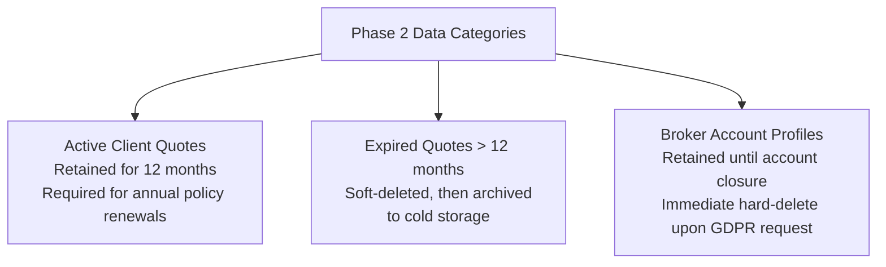

# Data Retention & Privacy Policy: DeltaCare

**Document Version**: 1.0.0  
**Phase**: Pre-Development Foundation Phase  
**Author**: Senior Privacy Architect & Database Governance Lead  
**Status**: Authoritative Architectural Baseline  
**Approved References**: [ADR-004](../decisions/004-stateless-b2c-mvp.md), [ADR-010](../decisions/010-structured-stdout-log-sanitization.md)

---

## 1. Phase 1 Data Retention Policy: Instant Purge (Zero Retention)

For Phase 1 (MVP), DeltaCare enforces an **Instant Ephemeral Purge Policy**:

| Data Category | Examples | Retention Duration | Storage Medium | Deletion Mechanism |
| :--- | :--- | :--- | :--- | :--- |
| **User Inputs** | Age, BMI, Smoker status, Region | **0 milliseconds** after HTTP response | Volatile Process RAM | Discarded by Python Garbage Collection upon function return. |
| **Calculated Quotes**| Predicted annual/monthly charges | **0 milliseconds** after HTTP response | Volatile Process RAM | Returned to client; zero server copies retained. |
| **Client IP Addresses** | `192.0.2.1` | **60 seconds** | `slowapi` In-Memory Dict | Expired automatically via token-bucket window. |
| **Server Logs** | HTTP status, latency, route | Transitory buffer (~48 hours) | Hugging Face Container STDOUT | Ephemeral stdout scrollback; flushed on container restart. |

---

## 2. Phase 2 Data Retention Policy (Planned B2B Broker Expansion)

When Phase 2 introduces authenticated broker client accounts:

---

## 3. Data Protection Principles (All Phases)

1. **Data Minimization**: The platform requests only the bare actuarial attributes mathematically required to execute the calculation. Zero secondary data (names, social handles, browser fingerprints) is collected.
2. **Right to Erasure (GDPR / CCPA)**:
   - **Phase 1**: Satisfied natively because zero data is stored.
   - **Phase 2**: An automated endpoint (`DELETE /api/v2/broker/clients/:id`) will execute cascading purges of all client records within 30 days of request.
3. **Data Export**:
   - In Phase 2, brokers can export all client records and quote histories in standard JSON/CSV format (`GET /api/v2/broker/export`).

