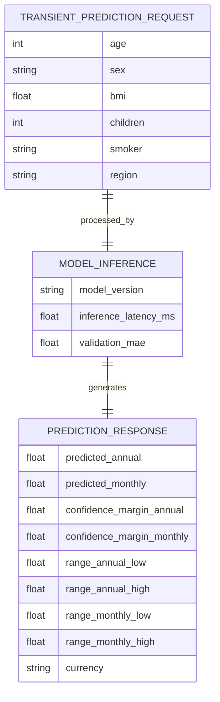
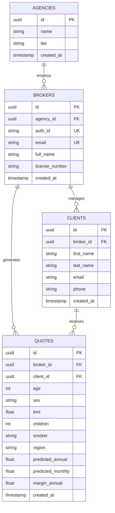

# Entity-Relationship (ER) Diagram: DeltaCare

**Document Version**: 1.0.0  
**Phase**: Pre-Development Foundation Phase  
**Author**: Principal Database Architect  
**Status**: Authoritative Architectural Baseline  
**Approved References**: [ADR-004](../decisions/004-stateless-b2c-mvp.md)

---

## 1. Phase 1 Conceptual Entity Diagram (Stateless Transaction)

In Phase 1, data exists exclusively as a **transient transactional entity** during the HTTP request/response lifecycle:

---

## 2. Phase 2 Relational ER Diagram (Planned B2B Expansion)

The relational data model planned for Phase 2 links broker agencies, licensed agents, clients, and saved quote histories:

### Explanation of Relationships
- An **Agency** employs one or more **Brokers** (`1:N`).
- A **Broker** manages multiple prospective **Clients** (`1:N`).
- A **Client** can receive multiple historical **Quotes** over time (`1:N`).
- A **Quote** belongs to exactly one **Broker** and one **Client** (`N:1`), capturing an immutable financial estimate at a specific point in time.

