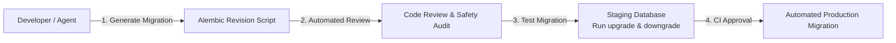

# Migration Policy & Schema Evolution: DeltaCare

**Document Version**: 1.0.0  
**Phase**: Pre-Development Foundation Phase  
**Author**: Principal Database Architect  
**Status**: Authoritative Architectural Baseline  
**Approved References**: [ADR-004](../decisions/004-stateless-b2c-mvp.md)

---

## 1. Phase 1 Policy: Machine Learning Artifact Evolution

In Phase 1 (MVP), **there are no database migrations** because the application is 100% stateless.

Instead, schema and model evolution follow the **ML Pipeline Versioning Protocol**:
1. When input dataset features or model hyperparameters change, the developer modifies `scripts/train_model.py`.
2. The headless script trains a new pipeline and updates `apps/api/models/model.joblib`.
3. Automated benchmark gates in `scripts/audit_model.py` must pass ($R^2 \ge 0.85$, $\text{MAE} \le \$2,000$).
4. The Git commit atomically bundles the code changes and the Git LFS-tracked `model.joblib` artifact.

---

## 2. Phase 2 Relational Migration Governance (Planned PostgreSQL)

When persistence is provisioned in Phase 2, schema evolution will be strictly governed by **Alembic Database Migrations**:

---

## 3. Mandatory Migration Rules (Phase 2)

Every future database migration must satisfy seven strict governance rules:

1. **Explicit Versioned Script**: Every schema change must have a forward migration (`upgrade()`) and a tested rollback migration (`downgrade()`) generated via Alembic.
2. **Zero Raw SQL in Production**: Manual `ALTER TABLE` or `DROP COLUMN` commands executed directly on production instances via psql are **strictly prohibited**.
3. **Non-Destructive Column Additions**: New columns must be added as `NULL` or provide an explicit default value to prevent breaking running API instances during rolling deployments.
4. **Data Preservation Guarantee**: Migrations must never drop existing data columns without a preceding two-step deprecation cycle (Mark Deprecated $\rightarrow$ Extract $\rightarrow$ Drop).
5. **Pre-Deployment Staging Test**: Migrations must be applied to an isolated staging database replica and verified before production execution.
6. **Zero-Downtime Compatibility**: Schema changes must maintain backward compatibility with the currently running API code until the new container deployment completes.
7. **AI Agent Permission Restriction**: AI coding agents are categorized under **RESTRICTED** permissions for database migrations and must obtain explicit Technical Lead approval before authoring or executing any migration script.

