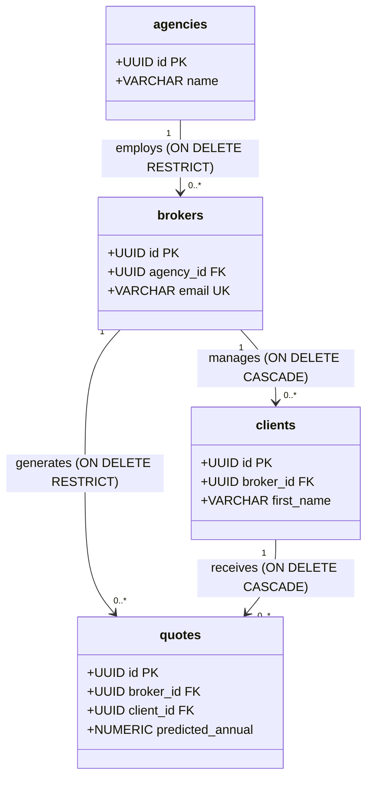

# Table Relationships & Referential Integrity: DeltaCare

**Document Version**: 1.0.0  
**Phase**: Pre-Development Foundation Phase  
**Author**: Principal Database Architect  
**Status**: Authoritative Architectural Baseline  
**Approved References**: [ADR-004](../decisions/004-stateless-b2c-mvp.md)

---

## 1. Phase 1 Policy: Zero Tables & Zero Foreign Keys

Because Phase 1 operates completely statelessly in volatile process memory, **there are no database tables or foreign key relationships in Phase 1**.

Referential integrity in Phase 1 is replaced by **Pydantic Schema Validation Rules** enforcing valid ranges and types directly at the API gateway.

---

## 2. Phase 2 Relational Cardinality & Cascade Rules

When PostgreSQL persistence is activated in Phase 2 for the B2B Broker Portal, referential integrity will be strictly governed by relational foreign key constraints and cascade policies:

---

## 3. Referential Action Matrix (Phase 2)

| Relationship | Parent Table | Child Table | Foreign Key Column | Action on Parent Deletion | Action on Parent Update |
| :--- | :--- | :--- | :--- | :--- | :--- |
| **Agency $\rightarrow$ Broker** | `agencies` | `brokers` | `agency_id` | `ON DELETE RESTRICT` (Cannot delete agency with active brokers) | `ON UPDATE CASCADE` |
| **Broker $\rightarrow$ Client** | `brokers` | `clients` | `broker_id` | `ON DELETE CASCADE` (Deleting broker deletes client records) | `ON UPDATE CASCADE` |
| **Client $\rightarrow$ Quote** | `clients` | `quotes` | `client_id` | `ON DELETE CASCADE` (Deleting client purges associated quotes) | `ON UPDATE CASCADE` |
| **Broker $\rightarrow$ Quote** | `brokers` | `quotes` | `broker_id` | `ON DELETE RESTRICT` (Historical quotes preserved for agency audits) | `ON UPDATE CASCADE` |

---

## 4. Referential Integrity Guarantees

1. **No Orphaned Records**: Foreign keys enforce that quotes cannot exist without a valid target client and generating broker.
2. **UUID Primary Keys**: All tables utilize Version 4 UUIDs (`gen_random_uuid()`) to prevent predictable sequential enumeration attacks across multi-tenant agencies.

