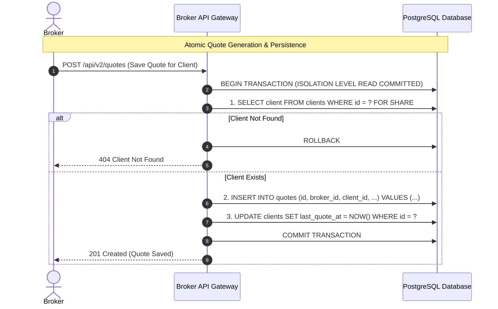

# Transaction Rules & Atomic Operations: DeltaCare

**Document Version**: 1.0.0  
**Phase**: Pre-Development Foundation Phase  
**Author**: Principal Database Architect  
**Status**: Authoritative Architectural Baseline  
**Approved References**: [ADR-004](../decisions/004-stateless-b2c-mvp.md)

---

## 1. Phase 1 Policy: In-Memory Request Isolation

In Phase 1 (MVP), **every prediction request is inherently atomic and isolated by process memory boundaries**:

1. **Zero Database Transactions**: There are no `BEGIN`, `COMMIT`, or `ROLLBACK` SQL statements because there is no persistent database.
2. **Transactional Request Semantics**:
   - A `POST /predict` invocation either completes successfully (returns HTTP 200 with complete JSON) or fails cleanly (returns HTTP 422, 429, or 500).
   - Because the backend does not mutate state or write to disk, partial failures are impossible.
3. **Thread Safety**: The singleton `model.joblib` pipeline executes read-only operations during inference (`pipeline.predict()`), making it completely thread-safe across concurrent async Uvicorn workers.

---

## 2. Phase 2 Relational Transaction Governance (Planned B2B Expansion)

When Phase 2 introduces PostgreSQL persistence, state-mutating operations will follow strict ACID transaction boundaries:

---

## 3. Transaction Boundary Rules (Phase 2)

1. **Short-Lived Transactions**:
   - The machine learning calculation must execute **before** opening a database transaction.
   - Long-running computations, external HTTP requests, and PDF rendering must **never** occur inside an open database transaction block.
2. **Explicit Rollback on Error**:
   - Every multi-statement database operation must be wrapped in an atomic `try...except` block using an async transaction context manager (e.g., `async with session.begin():`).
   - Any unhandled exception triggers an immediate `ROLLBACK`.
3. **Isolation Level Standard**: Standardize on **`READ COMMITTED`**, which provides optimal balance between high concurrency throughput and query isolation for financial records.

