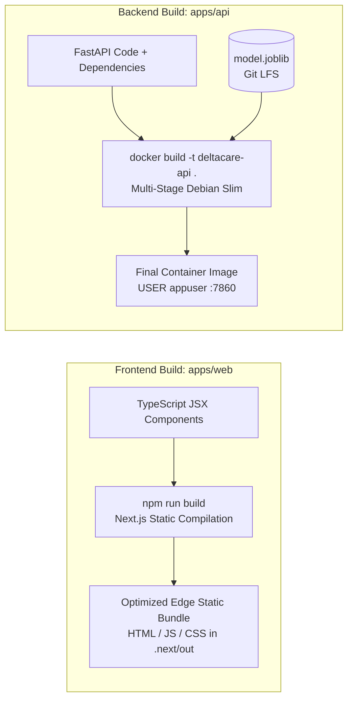

# Build Process & Packaging Architecture: DeltaCare

**Document Version**: 1.0.0  
**Phase**: Pre-Development Foundation Phase  
**Author**: Senior DevOps Engineer & Platform Architect  
**Status**: Authoritative DevOps Baseline  
**Approved References**: [ADR-002](../decisions/002-zero-dollar-hosting-strategy.md), [ADR-003](../decisions/003-unified-sklearn-pipeline.md)

---

## 1. Decoupled Build Topology

DeltaCare enforces a complete separation of build processes between the frontend web client and the backend containerized API:



---

## 2. Backend Container Packaging Specification (`apps/api/Dockerfile`)

The backend container is designed specifically for **Hugging Face Spaces Free CPU Tier**:
- Base Image: `python:3.10-slim` (Minimal attack surface and memory footprint).
- Non-Root User: UID 1000 (`appuser`).
- Exposed Port: `7860` (Standard Hugging Face Spaces ingress port).

```dockerfile
# Proposed apps/api/Dockerfile specification
FROM python:3.10-slim

# Prevent Python from writing .pyc files and buffer stdout/stderr
ENV PYTHONDONTWRITEBYTECODE=1 \
    PYTHONUNBUFFERED=1 \
    PORT=7860

# Create unprivileged application user
RUN useradd -m -u 1000 appuser

WORKDIR /app

# Install system dependencies (curl for health check)
RUN apt-get update && apt-get install -y --no-install-recommends \
    curl \
    && rm -rf /var/lib/apt/lists/*

# Install pinned Python dependencies
COPY requirements.txt .
RUN pip install --no-cache-dir -r requirements.txt

# Copy serialized ML model and application source code
COPY --chown=appuser:appuser models/ models/
COPY --chown=appuser:appuser src/ src/

USER appuser

EXPOSE 7860

# Health check instruction
HEALTHCHECK --interval=30s --timeout=5s --start-period=10s --retries=3 \
  CMD curl -f http://localhost:7860/health || exit 1

# Launch ASGI server via Uvicorn binding to 0.0.0.0:7860
CMD ["uvicorn", "src.main:app", "--host", "0.0.0.0", "--port", "7860"]
```

---

## 3. Frontend Static Compilation Specification (`apps/web`)

The Next.js client compiles to an optimized edge bundle:
- Build Command: `npm run build`
- Target Output: Optimized static HTML and JavaScript assets distributed globally via Vercel Edge Anycast CDN.
- Bundle Budget: Initial JavaScript bundle must not exceed **$150\text{KB}$ gzip** to maintain sub-second First Contentful Paint.

