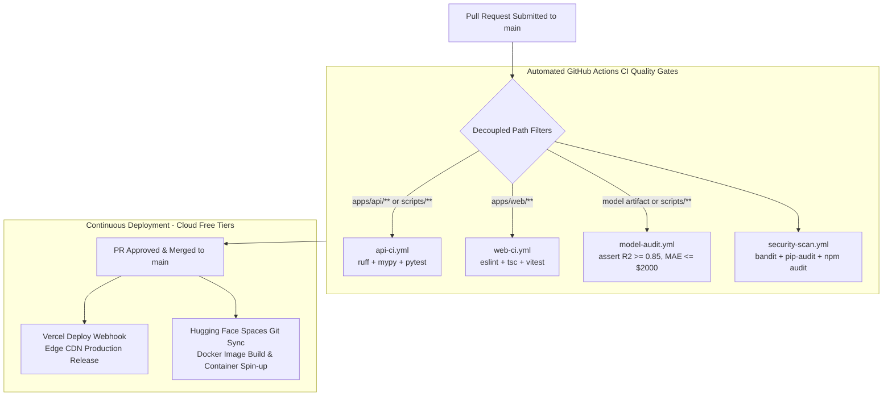

# CI/CD Automation Strategy: DeltaCare

**Document Version**: 1.0.0  
**Phase**: Pre-Development Foundation Phase  
**Author**: Senior DevOps Engineer & Platform Architect  
**Status**: Authoritative DevOps Baseline  
**Approved References**: [ADR-001](../decisions/001-decoupled-monorepo.md), [ADR-002](../decisions/002-zero-dollar-hosting-strategy.md)

---

## 1. Automated Pipeline Architecture

DeltaCare's continuous integration and continuous deployment pipelines are powered by **GitHub Actions**, with decoupled deployment targets on **Vercel** and **Hugging Face Spaces**.

---

## 2. GitHub Actions Workflow Specifications

### 2.1 Backend CI Workflow (`.github/workflows/api-ci.yml`)
- **Triggers**: Pull requests modifying `apps/api/**`, `scripts/**`, or `.github/workflows/api-ci.yml`.
- **Jobs**:
  1. **Lint & Style**: `ruff check apps/api/src apps/api/tests scripts`.
  2. **Static Typing**: `mypy --strict apps/api/src`.
  3. **Unit & API Tests**: `pytest apps/api/tests/ --cov=apps/api/src --cov-fail-under=85`.

### 2.2 Frontend CI Workflow (`.github/workflows/web-ci.yml`)
- **Triggers**: Pull requests modifying `apps/web/**` or `.github/workflows/web-ci.yml`.
- **Jobs**:
  1. **Linting**: `npm --prefix apps/web run lint`.
  2. **Type Checking**: `npm --prefix apps/web run typecheck` (`tsc --noEmit`).
  3. **Component Tests**: `npm --prefix apps/web test`.
  4. **Build Verification**: `npm --prefix apps/web run build` (Ensures zero bundle/compilation breaks).

### 2.3 Machine Learning Quality Audit (`.github/workflows/model-audit.yml`)
- **Triggers**: Pull requests modifying `apps/api/models/**` or `scripts/**`.
- **Job**:
  - Executes `python scripts/audit_model.py`.
  - Asserts holdout evaluation satisfies:
    $$\mathbf{R^2 \ge 0.85} \quad \text{and} \quad \mathbf{\text{MAE} \le \$2,000.00}$$
  - Fails the build immediately if predictive quality degrades.

